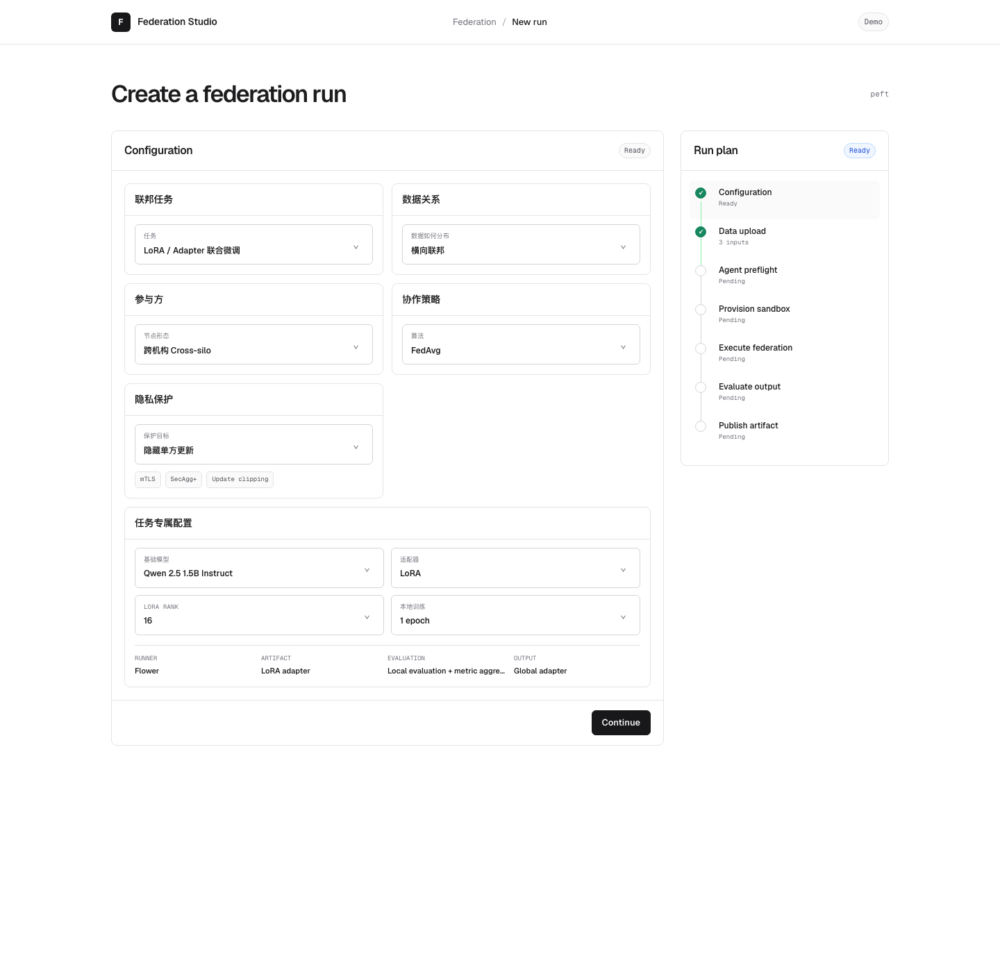

# Federation Studio

Federation Studio 是一个面向多类联邦任务的配置与运行控制台原型。用户先选择工作负载、数据关系、参与拓扑、协作策略和保护目标，平台再补充该方法特有的参数，并把配置解析成一条可审查的运行计划。

当前版本是 **0.1.0 前端原型**。配置逻辑、兼容选项、交互流程和运行状态机可以演示；容器创建、真实联邦算法、隐私计算和 Agent 准入仍是模拟能力，尚未连接生产后端。



## 当前支持的配置空间

- 工作负载：模型联合训练、LoRA / Adapter 联合微调、纵向联合建模、联邦评估、联邦统计分析、FedRAG、个性化联邦、异构模型协作、Agent / Skill 协作。
- 数据关系：横向、纵向、混合、无训练数据协作。
- 参与拓扑：Cross-silo、Cross-device、混合节点、本地模拟。
- 保护目标：基础保护、隐藏单方更新、样本级隐私、加密计算、可信执行环境、高保证组合。
- 方法专属参数：模型、框架、轮次、LoRA rank、PSI、索引、评测位置等，由工作负载动态决定。

运行时、评测方案和输出类型不是独立的无约束下拉框，而是由前述选择自动解析。这样可以避免产生“界面允许、工程上不能运行”的组合。

## 本地运行

需要 Node.js 20.19+ 或 22.12+。

```bash
cd app
npm install
npm run dev:demo
```

打开 <http://127.0.0.1:8880/>。

完整质量检查：

```bash
cd app
npm run check
```

## 项目状态

| 模块 | 状态 | 说明 |
|---|---|---|
| 分层配置 UI | 已完成 | 9 类工作负载及其方法专属配置 |
| 响应式向导 | 已完成 | 左侧步骤内容，右侧可点击时间轴 |
| 配置解析 | 已完成（原型） | 根据工作负载收窄数据关系、拓扑、策略与保护目标 |
| 数据上传 | 前端模拟 | 未保存文件，未接对象存储 |
| Agent 准入 | 前端模拟 | 未接规则服务或 LLM Agent |
| 沙箱与容器 | 未实现 | 当前只展示目标状态和配置摘要 |
| 联邦执行 | 未实现 | LoRA 路径保留 mock runner，其余仅配置演示 |
| 评测与发布 | 前端模拟 | 无真实指标、产物注册或下载链路 |
| 用户、权限、审计 | 未实现 | 进入后端阶段再设计 |

## 文档导航

- [项目目标](./docs/GOAL.md)
- [当前进展](./docs/PROGRESS.md)
- [系统架构](./docs/ARCHITECTURE.md)
- [运行流程](./docs/FLOW.md)
- [首个可执行场景](./docs/MVP_SCENARIO.md)
- [开发说明](./docs/DEVELOPMENT.md)
- [关键设计决策](./docs/DECISIONS.md)
- [历史演进](./docs/HISTORY.md)

## 目录

```text
federation-studio/
├── app/                  React + TypeScript 前端
│   └── src/
│       ├── domain/       配置注册表、兼容性、运行状态机与 mock 后端
│       ├── state/        页面状态与 reducer
│       └── ui/           向导、时间轴和各步骤内容
└── docs/                 产品、架构、流程、进展和开发文档
```

