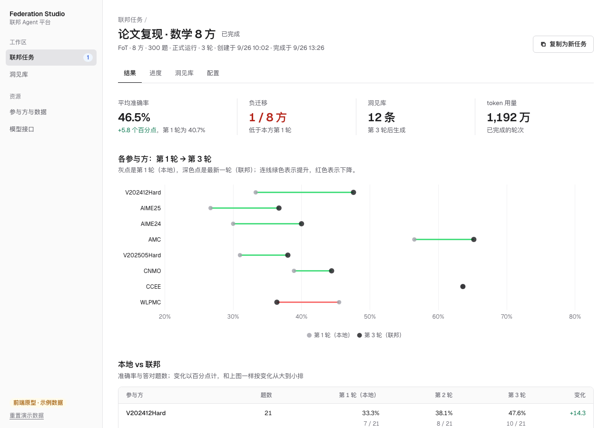

# Federation Studio · 联邦 Agent 平台

Federation Studio 让多个参与方的 Agent 在不交出题目、答案和原始数据的前提下一起变强。每个参与方的 Agent 在自己的任务上解题、反思，把推理经验提炼成文本（trace）上传；服务端把各方经验归类、合并成洞见库，再下发给所有参与方，用于下一轮。整个过程不传模型参数，也不需要梯度或标注。

使用顺序是先选场景，再选算法和数据。第一个算法是横向联邦场景下的 FoT（Federation over Text，[arXiv:2604.16778](https://arxiv.org/abs/2604.16778)）。

当前版本是 **0.4.0 前端原型**：页面和交互都已完成，任务运行、准确率、trace 和洞见库都是模拟生成的示例数据（侧栏始终标着"示例数据"），后端尚未接入。


## 场景、算法与数据

| 场景 | 在做什么 | 算法 | 数据 | 状态 |
|---|---|---|---|---|
| 横向联邦 Agent | 各方做同一类任务，但题目不同 | FoT | 内置 8 个数学题库（共 300 题），也可以上传同格式的题库 | 可用 |
| 纵向联邦 Agent | 同一批问题，各方掌握不同方面的信息 | 待接入 | 各方关于同一批对象的不同信息 | 规划中 |
| 联邦迁移 Agent | 把已有参与方的经验迁移给新领域的 Agent | 待接入 | 源领域的经验和目标领域的少量题目 | 规划中 |

每个算法只属于一个场景。纵向和迁移的算法接入后，作为新插件登记即可，页面和任务调度不用改。

## 用户怎么用

1. **选场景和算法**：在首页点"新建联邦任务"，选"横向联邦 Agent"，算法 FoT 会自动选上；展开 FoT 可以看每一轮的 6 步和上传内容。
2. **选数据**：在分组的复选表格里勾选，每份数据由一个参与方持有，至少选 2 份。自己的题库在"参与方与数据"里上传，浏览器会先检查格式。
3. **设参数并运行**：推荐值已填好，默认先试跑（每份前 5 题）。右侧显示调用次数、token、时长和费用的预估；正式运行开始前会再确认一次。
4. **看进度和结果**：任务详情分结果、进度、洞见库、配置四个标签，包括第 1 轮（本地）和最后一轮（联邦）的对比、负迁移、各轮洞见库，以及服务端实际收到的 trace。
5. **用洞见库**：发布一版洞见库后，可以在平台上试用（带库 / 不带库对比），也可以导出 JSON 放进自己的 Agent。

完整说明见 [使用流程](./docs/FLOW.md)。




## 整体架构


- **界面、命令行、参与方客户端共用一套 REST API。**
- **核心服务**：注册表（场景 → 算法 → 数据）、任务调度、算法运行时（插件）、评测与指标、洞见库服务。
- **FoT 引擎**：由已审计的论文复现器拆分而来，上游 Prompt 1–5 原样使用。
- **参与方的两种运行位置**：
  - 平台托管：由平台运行 Agent，适合公开数据和演示。
  - 参与方本地：参与方运行客户端，题库和模型密钥留在本地，只上传 trace。
- **资源**：平台侧的模型调用都经过模型网关，调用 OpenAI 兼容的 LLM API（先预留接口，服务和模型之后再配置）。平台不需要 GPU、K8s 或沙箱。

详见 [系统架构](./docs/ARCHITECTURE.md)。

## 本地运行

需要 Node.js 20.19+ 或 22.12+。

```bash
cd app
npm install
npm run dev:demo
```

打开 <http://127.0.0.1:8880/>。演示数据保存在浏览器本地，侧栏底部可以一键重置。

完整检查：

```bash
cd app
npm run check
```

## 项目状态

| 模块 | 状态 | 说明 |
|---|---|---|
| 场景 → 算法 → 数据的新建流程 | 已完成（前端） | 3 个场景，其中 FoT 可用；数据按任务类型匹配；调用量精确计算，token、时长、费用按口径预估 |
| 任务详情 | 已完成（示例数据） | 结果（本地 vs 联邦、负迁移、各方变化图）、进度（每轮 6 步 + 服务端收到的 trace）、洞见库各轮版本与关系分析、冻结的配置 |
| 洞见库 | 已完成（前端） | 发布、按类别浏览、导出 JSON（与 `library_r{n}.json` 同格式）；试用的回答为示意 |
| 参与方与数据 | 已完成（前端） | 平台托管 / 参与方本地；题库在浏览器内真实检查格式 |
| 模型接口 | 已预留（前端） | 默认 LLM 接口待配置；接口列表 + 新增 / 编辑表单（地址、模型、并发上限、单价）；不保存密钥 |
| 后端（FastAPI + FoT 引擎 + 模型网关） | 未实现 | 下一步：由复现器拆出 FoT 引擎，接上横向任务的真实运行 |
| 参与方本地客户端 | 未实现 | 真实跨机构部署时需要 |
| 纵向、迁移的算法 | 未确定 | 需要确定采用哪些方法 |

## 文档导航

- [项目目标](./docs/GOAL.md)
- [使用流程](./docs/FLOW.md)
- [系统架构](./docs/ARCHITECTURE.md)
- [当前进展](./docs/PROGRESS.md)
- [开发说明](./docs/DEVELOPMENT.md)
- [关键设计决策](./docs/DECISIONS.md)
- [任务记录](./docs/HISTORY.md)

## 目录

```text
federation-studio/
├── app/                  React + TypeScript 前端
│   └── src/
│       ├── domain/       场景与算法注册表、参与方与数据、任务配置与预估、任务状态机、示例数据、题库检查
│       ├── state/        页面状态、初始数据、模拟推进、本地保存、路由
│       └── ui/           联邦任务（首页 / 新建 / 详情）、洞见库、参与方与数据、模型接口
└── docs/                 目标、使用流程、架构、进展、决策和任务记录
```
