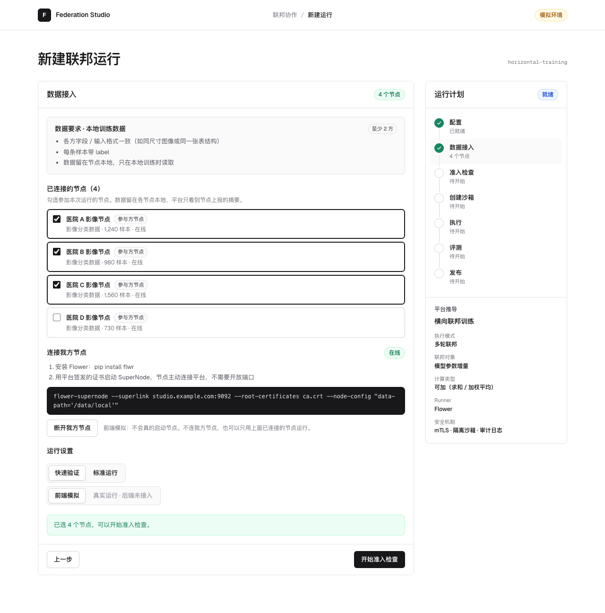
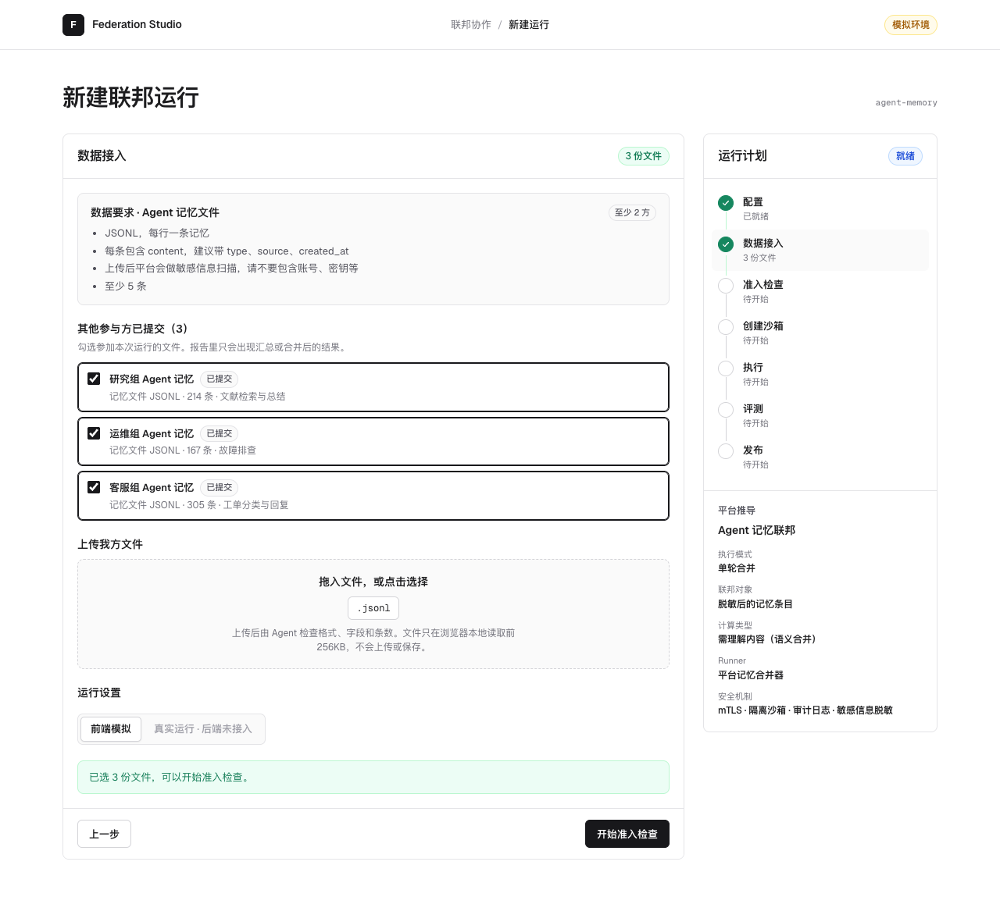
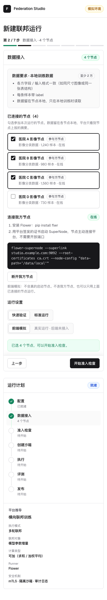

# Federation Studio

Federation Studio 是面向多种隐私协作任务的场景配置与运行控制台原型。平台不自己实现联邦算法，而是用一套统一的维度分层把联邦方法组织起来：用户先选 4 个场景之一，再选场景内的条件、协作策略和安全增强；平台推导执行模式、联邦对象、runner 和保护机制，再走完准入、沙箱、执行、评测和发布。

当前版本是 **0.2.0 前端原型**。维度分层、依赖规则、数据接入检查、运行计划和七步流程都可以演示；Agent 准入、沙箱、联邦执行、隐私计算、评测和发布都是前端模拟，尚未连接后端。


## 维度分层

| # | 维度 / 子项 | 回答的问题 |
|---|---|---|
| 1 | 场景 | 第一步先选。连接节点 · 多轮运行：横向联邦训练、纵向联邦训练；上传文件 · 一次完成：联邦统计分析、Agent 记忆联邦 |
| 1.1 | 模型类别 | 神经网络、树模型、线性模型，只在横向联邦训练 |
| 1.2 | 共享方式 | 全量参数、LoRA，只在横向联邦训练（LoRA 只适用于神经网络） |
| 2 | 协作策略 | 只列当前场景的策略（共 7 条） |
| 3 | 安全与隐私 | 内置保护自动生效；可选增强只列 runner 实际提供的（SecAgg+、差分隐私），可多选 |

| 场景 | 各方做什么 | 平台做什么 | 框架 |
|---|---|---|---|
| 横向联邦训练 | 启动 Flower 节点，本地训练 | 每轮合并模型（全量参数或 LoRA） | Flower |
| 纵向联邦训练 | 启动 NVFlare 节点，交换加密中间结果 | 协调隐私求交和训练步骤 | NVFlare |
| 联邦统计分析 | 上传本地汇总的统计表 | 由计数和求和算整体结果，小分组不公布 | 平台统计服务 |
| Agent 记忆联邦 | 上传 Agent 记忆文件 | 脱敏、去重、处理冲突、回放验证，生成新记忆供下载 | 平台记忆合并器 |

demo 阶段只收录最通用、最主流的方法，Agent / 大模型相关的方法例外保留；参与方只支持跨机构。横向训练照 Flower 的方式做（平台是 SuperLink，各方是 SuperNode）；FATE 自 2024 年 7 月后没有新版本，纵向改用 NVFlare。子项只在横向联邦训练出现，不能取消；其他选项再点一次即取消，再点一次当前场景即取消场景。所有候选项始终展开，只剩一个选项时自动选中。轮次等运行默认值不在界面展示。完整设计见 [DIMENSIONS.md](./docs/DIMENSIONS.md)。








## 本地运行

需要 Node.js 20.19+ 或 22.12+。

```bash
cd app
npm install
npm run dev:demo
```

打开 <http://127.0.0.1:8880/>。

完整质量检查：

```bash
cd app
npm run check
```

## 项目状态

| 模块 | 状态 | 说明 |
|---|---|---|
| 维度分层与依赖规则 | 已完成（前端） | 3 个维度、4 个场景（训练场景含 2 个子项）、7 条策略；安全为内置保护 + 2 种可选增强 |
| 运行计划推导 | 已完成（前端） | FrontendRunPlan：执行模式、联邦对象、runner、执行位置 |
| 七步向导 | 已完成 | 左侧步骤内容，右侧时间轴与平台推导面板；手机端顶部进度条、操作栏吸底；界面统一中文 |
| 数据接入 | 前端（参与方为演示数据） | 节点类场景勾选已连接的节点、模拟我方节点上线并给出启动命令；文件类场景上传文件由 Agent 检查格式、字段和条数（浏览器本地解析，不上传） |
| Agent 准入 | 前端模拟 | 确定性规则 + 说明文案，未接规则服务或 LLM Agent |
| 沙箱、执行、评测 | 前端模拟 | 每个场景按自己的执行模式模拟，并显示真实耗时预估 |
| 发布 | 前端模拟 | 手动确认发布范围，不生成真实文件 |
| 后端、身份、权限、审计 | 未实现 | 分层确认后先做两个后端 demo |

## 文档导航

- [项目目标](./docs/GOAL.md)
- [配置维度设计](./docs/DIMENSIONS.md)
- [当前进展](./docs/PROGRESS.md)
- [系统架构](./docs/ARCHITECTURE.md)
- [运行流程](./docs/FLOW.md)
- [后端 demo 候选](./docs/MVP_SCENARIO.md)
- [开发说明](./docs/DEVELOPMENT.md)
- [关键设计决策](./docs/DECISIONS.md)
- [任务记录](./docs/HISTORY.md)

## 目录

```text
federation-studio/
├── app/                  React + TypeScript 前端
│   └── src/
│       ├── domain/       维度注册表、选择引擎、运行计划、状态机、模拟器
│       ├── state/        页面状态与模拟驱动
│       └── ui/           逐层配置、各步骤视图、时间轴
└── docs/                 产品、维度、架构、流程、进展和开发文档
```
