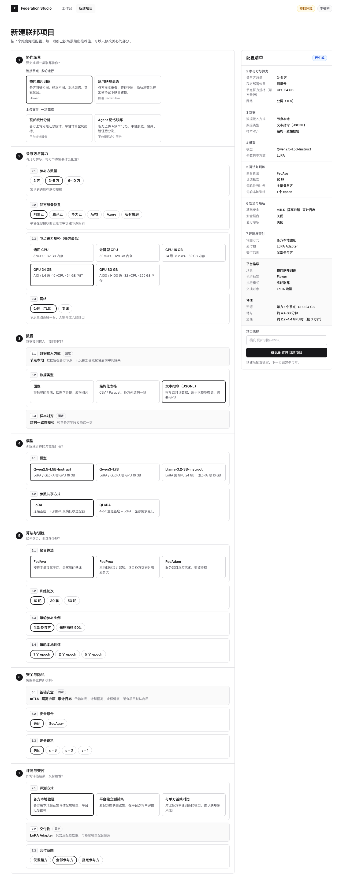
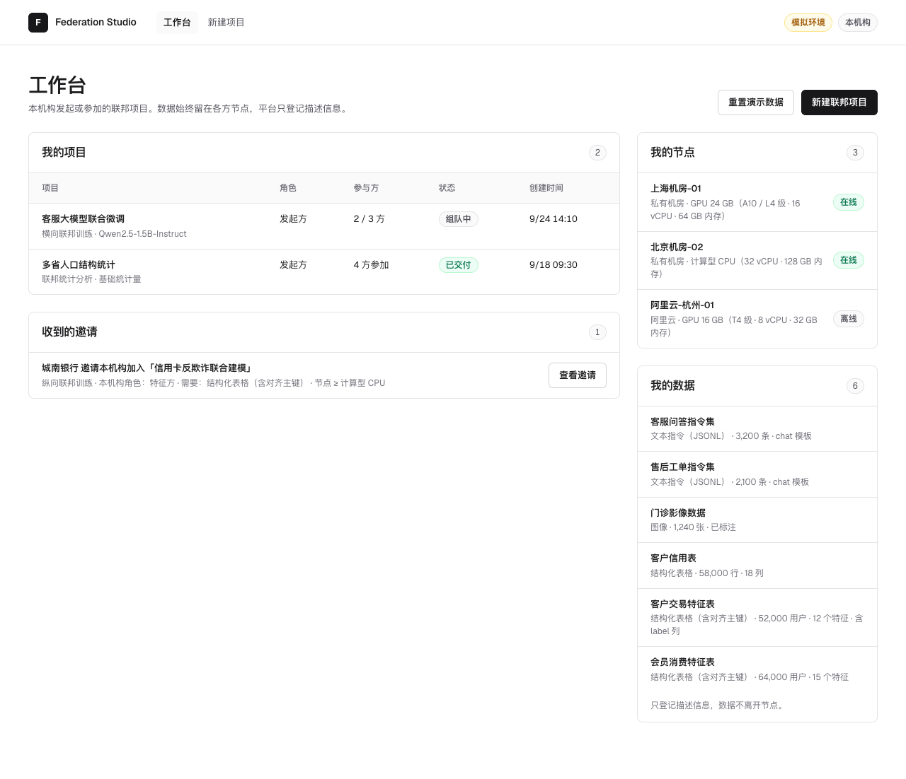
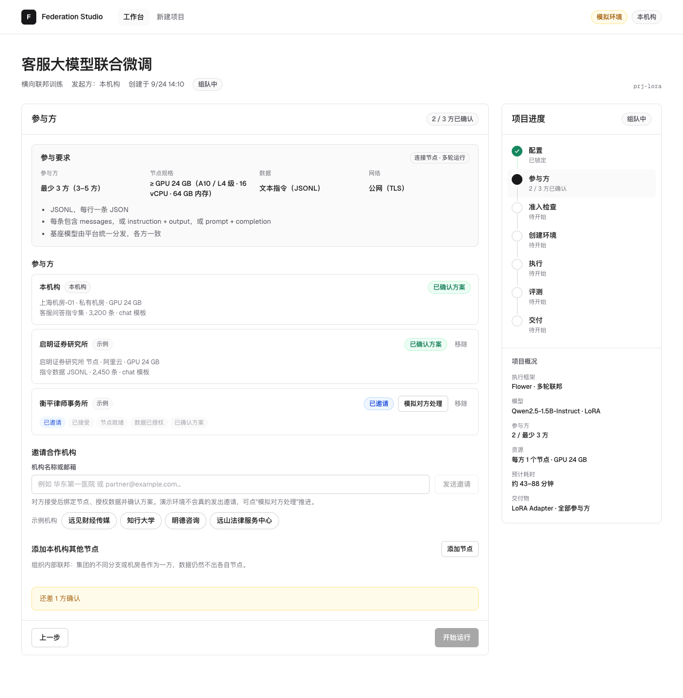
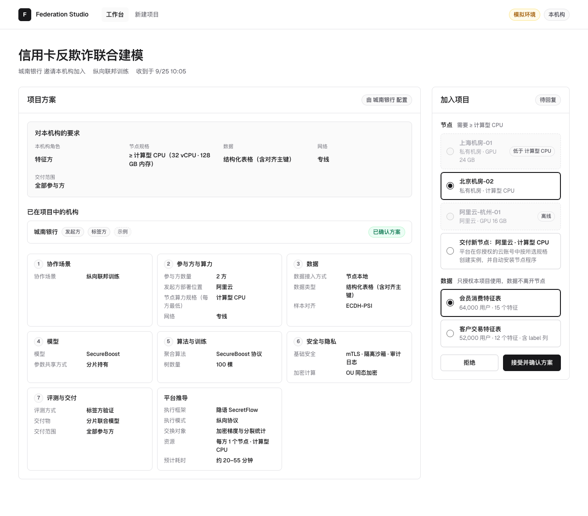
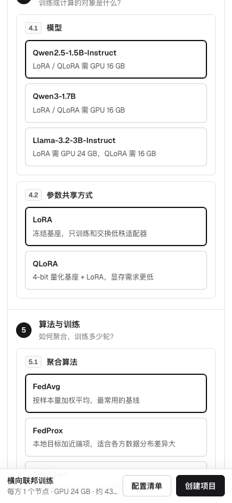
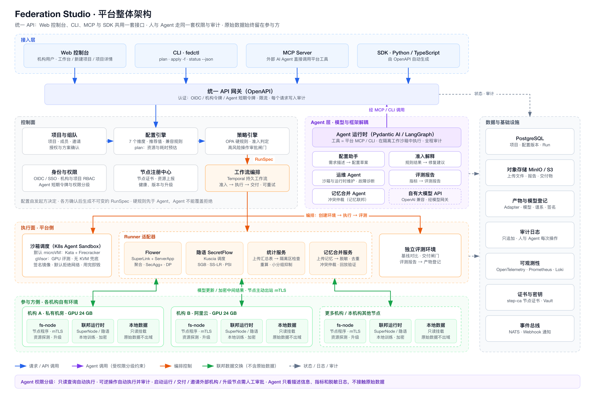

# Federation Studio

Federation Studio 是面向跨机构隐私协作的联邦项目平台原型。平台不自己实现联邦算法，而是把主流联邦方法的共同特征整理成 7 个配置维度：机构像订阅云服务一样一步步选好配置，创建项目后邀请合作机构或加入本机构的其他节点组队，各方确认方案后，平台完成准入、创建环境、执行、评测和交付。具体算法由 Flower、隐语 SecretFlow 等现有框架执行。

当前版本是 **0.3.0 前端原型**。配置、组队、邀请、节点交付和七步运行流程都可以演示；节点连接、Agent 准入、联邦执行、隐私计算、评测和交付都是前端模拟，尚未连接后端。



## 7 个维度

| # | 维度 | 子项 |
|---|---|---|
| 1 | 协作场景 | 横向联邦训练、纵向联邦训练（连接节点 · 多轮运行）；联邦统计分析、Agent 记忆联邦（上传文件 · 一次完成） |
| 2 | 参与方与算力 | 参与方数量、部署位置（阿里云 / 腾讯云 / 华为云 / AWS / Azure / 私有机房）、节点算力规格（CPU 两档、GPU 16 / 24 / 80 GB）、网络 |
| 3 | 数据 | 接入方式、数据类型、样本对齐（ECDH-PSI / RR22-PSI） |
| 4 | 模型 | ResNet-18、MLP、XGBoost、逻辑回归、Qwen2.5-1.5B、Qwen3-1.7B、Llama-3.2-3B、SecureBoost、SS-LR 等；参数共享方式（LoRA / QLoRA 等） |
| 5 | 算法与训练 | FedAvg / FedProx / FedAdam / XGBoost Bagging、轮次、每轮参与比例、每轮本地训练 |
| 6 | 安全与隐私 | 基础安全、SecAgg+、差分隐私、同态加密（OU / Paillier）或秘密分享、输出保护 |
| 7 | 评测与交付 | 评测方式、交付物、交付范围 |

选完场景即按推荐值得到一份完整配置，只需修改关心的部分。算力规格约束后面的选择，例如 CPU 节点不能选大模型、GPU 16 GB 时 Llama-3.2-3B 只能用 QLoRA。执行框架、执行模式、交换对象、资源与耗时预估由平台推导，显示在订单摘要里。完整设计见 [DIMENSIONS.md](./docs/DIMENSIONS.md)。

## 使用方式

- **发起 + 邀请**：发起方配置并创建项目，邀请合作机构；对方接受、绑定节点、授权数据并确认方案后开始运行。
- **组织内部联邦**：同一机构的多个节点（或多份文件）各作为一方。
- 演示环境预置了示例机构、节点、数据、两个项目和一份收到的邀请；数据保存在浏览器本地，工作台可一键重置。









## 整体架构



Web 控制台、CLI（`fedctl`）、MCP Server 和 SDK 共用一套 OpenAPI，人和 Agent 走同一套权限与审计；每次运行按需创建隔离沙箱；参与方只装一个节点程序，原始数据不出域。详见 [ARCHITECTURE.md](./docs/ARCHITECTURE.md)（目标架构，后端尚未实现）。

## 本地运行

需要 Node.js 20.19+ 或 22.12+。

```bash
cd app
npm install
npm run dev:demo
```

打开 <http://127.0.0.1:8880/>。

完整质量检查：

```bash
cd app
npm run check
```

## 项目状态

| 模块 | 状态 | 说明 |
|---|---|---|
| 7 个维度与依赖规则 | 已完成（前端） | 4 个场景、22 个子项、12 个模型，全部带推荐值和置灰规则 |
| 运行计划推导 | 已完成（前端） | FrontendRunPlan v2：执行框架、执行模式、交换对象、参与要求、安全机制、资源与耗时预估 |
| 工作台、项目、邀请 | 已完成（前端模拟） | 发起 + 邀请、组织内部多节点、节点交付、受邀方确认 |
| Agent 准入 | 前端模拟 | 确定性规则（含节点算力核对）+ 说明文案 |
| 创建环境、执行、评测、交付 | 前端模拟 | 每个场景按自己的执行模式模拟，并显示真实耗时预估 |
| 后端、身份、权限、审计 | 未实现 | 下一步做两个后端 demo：横向联邦训练（Flower）和一个上传类场景 |

## 文档导航

- [改版方案：联邦 Agent 平台（待确认）](./docs/PROPOSAL.md)
- [项目目标](./docs/GOAL.md)
- [配置维度设计](./docs/DIMENSIONS.md)
- [运行流程](./docs/FLOW.md)
- [系统架构](./docs/ARCHITECTURE.md)
- [当前进展](./docs/PROGRESS.md)
- [后端 demo 候选](./docs/MVP_SCENARIO.md)
- [开发说明](./docs/DEVELOPMENT.md)
- [关键设计决策](./docs/DECISIONS.md)
- [任务记录](./docs/HISTORY.md)

## 目录

```text
federation-studio/
├── app/                  React + TypeScript 前端
│   └── src/
│       ├── domain/       注册表、7 个维度、配置引擎、运行计划、项目与组队、状态机、模拟器
│       ├── state/        页面状态、初始数据、模拟计时、本地保存、路由
│       └── ui/           工作台、新建项目、项目详情、邀请
└── docs/                 产品、维度、流程、架构、进展和开发文档
```
