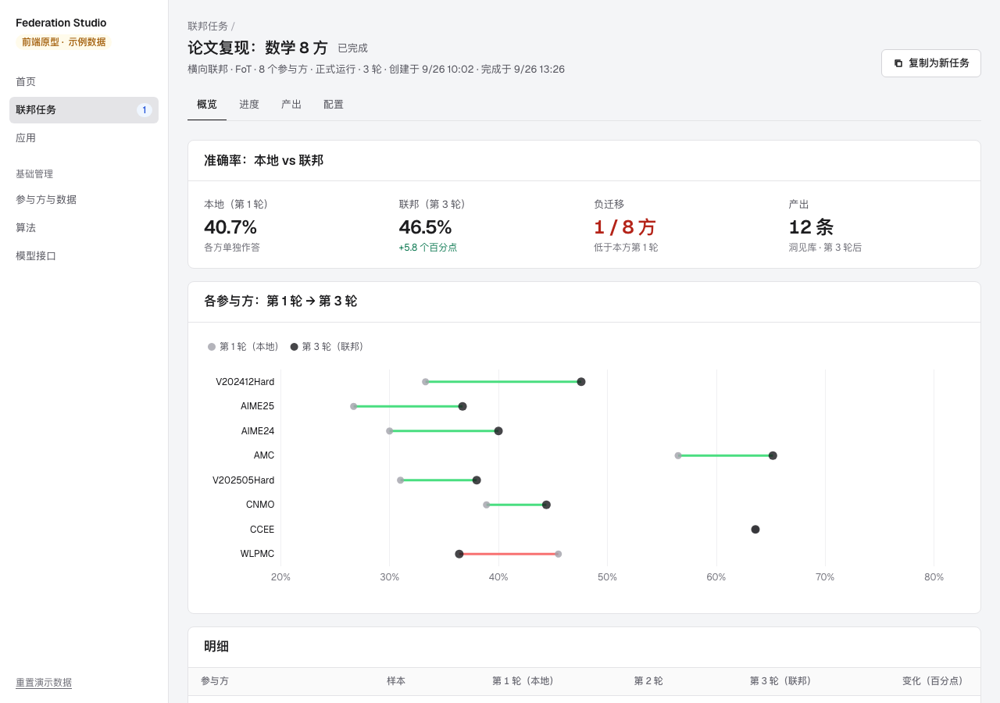

# Federation Studio · 联邦 Agent 平台

Federation Studio 是通用的联邦 Agent 平台：多个参与方的 Agent 在数据不出本地的前提下协作变强。平台按"场景 → 算法 → 参与方"组织联邦任务，算法以插件接入，各自声明交换什么、产出什么；任务的产出可以发布为应用，试用或接入自己的 Agent。

目前登记的算法是横向联邦场景下的 FoT（Federation over Text，[arXiv:2604.16778](https://arxiv.org/abs/2604.16778)），用来做演示：各参与方只上传文本推理经验（trace），服务端合成洞见库。纵向和迁移的算法待接入。

当前版本是 **0.4.0 前端原型**：页面和交互都已完成，任务运行、指标和产出都是模拟生成的示例数据（侧栏始终标着"示例数据"），后端尚未接入。


## 场景、算法与数据

| 场景 | 在做什么 | 算法 | 数据 | 状态 |
|---|---|---|---|---|
| 横向联邦 Agent | 各方做同类任务、数据不同 | FoT | 内置 8 个数学推理数据集（共 300 条样本），也可以上传同格式的数据集 | 可用 |
| 纵向联邦 Agent | 同一批对象，各方掌握不同方面的信息 | 待接入 | 各方关于同一批对象的不同信息 | 规划中 |
| 联邦迁移 Agent | 把已有参与方的经验迁移到新领域 | 待接入 | 源领域经验和目标领域的少量数据 | 规划中 |

每个算法只属于一个场景。新算法作为插件登记（适用场景、任务类型、交换内容、产出、参数、每轮步骤），新建任务、进度、产出和算法页面都按注册表生成，不用改页面。

## 用户怎么用

1. **新建任务**：点"新建联邦任务"，按云平台"创建实例"的方式逐块配置：场景（选项按钮）、算法（带单选的表格）、参与方（带复选框的表格）、运行方式和轮次（选项按钮）、模型（下拉）；算法参数收在"高级配置"里，默认值即推荐值。右侧是配置摘要和调用量、token、时长、费用的预估。
2. **看任务**：任务详情分概览、进度、产出、配置四个标签——本地（第 1 轮）与联邦（最新一轮）的指标对比、每轮进度和通信记录、每轮的产出。
3. **用产出**：把一版产出发布为应用，在"应用"里试用（不带 / 带应用对比）、查看内容，或导出 JSON 接入自己的 Agent。
4. **管理资源**：在"基础管理"里管理参与方与数据（平台托管或参与方本地）、查看算法、配置模型接口。

完整说明见 [使用流程](./docs/FLOW.md)。




## 整体架构


- **界面、命令行、参与方客户端共用一套 REST API。**
- **核心服务**：注册表（场景 → 算法 → 数据）、任务调度、算法运行时（插件）、评测与指标、产出与应用服务。
- **FoT 引擎**：由已审计的论文复现器拆分而来，上游 Prompt 1–5 原样使用。
- **参与方的两种运行位置**：
  - 平台托管：由平台运行 Agent，适合公开数据和演示。
  - 参与方本地：参与方运行客户端，题库和模型密钥留在本地，只上传 trace。
- **资源**：平台侧的模型调用都经过模型网关，调用 OpenAI 兼容的 LLM API（先预留接口，服务和模型之后再配置）。平台不需要 GPU、K8s 或沙箱。

详见 [系统架构](./docs/ARCHITECTURE.md)。

## 本地运行

需要 Node.js 20.19+ 或 22.12+。

```bash
cd app
npm install
npm run dev:demo
```

打开 <http://127.0.0.1:8880/>。演示数据保存在浏览器本地，侧栏底部可以一键重置。

完整检查：

```bash
cd app
npm run check
```

## 项目状态

| 模块 | 状态 | 说明 |
|---|---|---|
| 场景 → 算法 → 数据的新建流程 | 已完成（前端） | 3 个场景，其中 FoT 可用；数据按任务类型匹配；调用量精确计算，token、时长、费用按口径预估 |
| 任务详情 | 已完成（示例数据） | 结果（本地 vs 联邦、负迁移、各方变化图）、进度（每轮 6 步 + 服务端收到的 trace）、洞见库各轮版本与关系分析、冻结的配置 |
| 洞见库 | 已完成（前端） | 发布、按类别浏览、导出 JSON（与 `library_r{n}.json` 同格式）；试用的回答为示意 |
| 参与方与数据 | 已完成（前端） | 平台托管 / 参与方本地；题库在浏览器内真实检查格式 |
| 模型接口 | 已预留（前端） | 默认 LLM 接口待配置；接口列表 + 新增 / 编辑表单（地址、模型、并发上限、单价）；不保存密钥 |
| 后端（FastAPI + FoT 引擎 + 模型网关） | 未实现 | 下一步：由复现器拆出 FoT 引擎，接上横向任务的真实运行 |
| 参与方本地客户端 | 未实现 | 真实跨机构部署时需要 |
| 纵向、迁移的算法 | 未确定 | 需要确定采用哪些方法 |

## 文档导航

- [项目目标](./docs/GOAL.md)
- [使用流程](./docs/FLOW.md)
- [系统架构](./docs/ARCHITECTURE.md)
- [当前进展](./docs/PROGRESS.md)
- [开发说明](./docs/DEVELOPMENT.md)
- [关键设计决策](./docs/DECISIONS.md)
- [任务记录](./docs/HISTORY.md)

## 目录

```text
federation-studio/
├── app/                  React + TypeScript 前端
│   └── src/
│       ├── domain/       场景、任务类型与算法注册表，参与方与数据，任务配置与预估，任务状态机，示例数据，数据集检查
│       ├── state/        页面状态、初始数据、模拟推进、本地保存、路由
│       └── ui/           首页、联邦任务（列表 / 新建 / 详情）、应用、基础管理（参与方与数据、算法、模型接口）
└── docs/                 目标、使用流程、架构、进展、决策和任务记录
```
