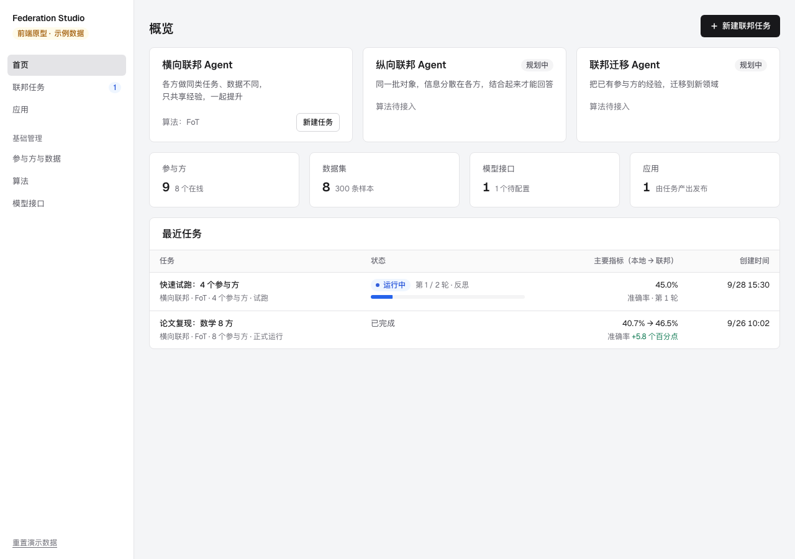
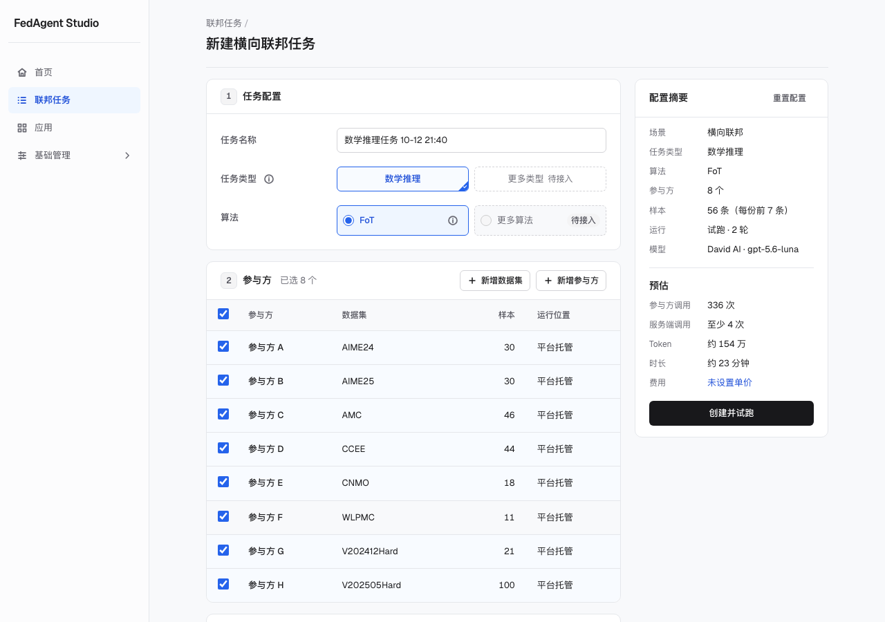
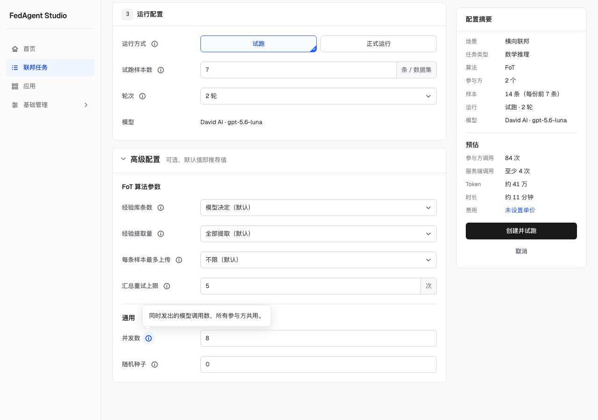
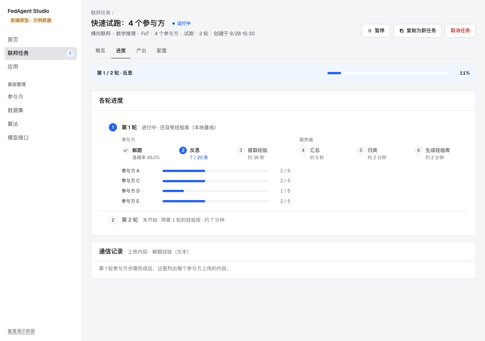
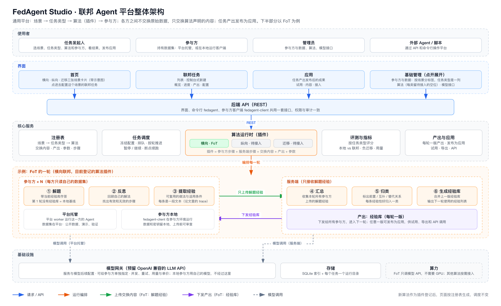

# FedAgent Studio · 联邦 Agent 平台

FedAgent Studio 是通用的联邦 Agent 平台：多个参与方的 Agent 协作变强，各方之间不交换原始数据，只交换算法需要的内容。

平台上的一次协作叫**联邦任务**：依次选择场景、算法及其支持的任务类型，几个参与方各出一份数据集，让各方的 Agent 协作几轮；完成后对比各方"单独作答"和"联邦之后"的效果，任务的产出可以发布为应用，试用或接入自己的 Agent。算法以插件接入，各自声明交换什么、产出什么；所有场景和算法都用同一种联邦任务。

## 几个概念

| 概念 | 是什么 | 由谁定、在哪里管理 |
|---|---|---|
| 场景 | 各方的数据怎么分布：横向、纵向、迁移 | 注册表；首页说明 |
| 任务类型 | Agent 要做的事，例如数学推理；决定数据格式和评估指标 | 注册表 |
| 算法 | 各方怎么协作，例如 FoT；每个算法只属于一个场景 | 注册表；"算法"页 |
| 参与方 | 参加联邦的机构或节点，原始数据不出本方；本身不绑定场景 | 用户登记；"参与方与数据"页 |
| 数据集 | 属于某个参与方；登记时选定场景和任务类型，只能用于同一场景、同一任务类型的联邦任务 | 用户登记；"参与方与数据"页 |
| 联邦任务 | 依次选择场景、算法及其支持的任务类型，几个参与方各出一份匹配的数据集，协作几轮 | 用户新建；"联邦任务"页 |

目前登记的算法是横向联邦场景下的 FoT（Federation over Text，[arXiv:2604.16778](https://arxiv.org/abs/2604.16778)），用来做演示：各参与方只上传解题经验（论文里的 trace），服务端汇总成共享的经验库。纵向和迁移的算法待接入。

当前版本：前端 0.5.0、后端 0.1.0。前后端第一版都已完成，任务真实运行，部署在实验室服务器上（只在 Tailscale 内网访问）。模型用任意 OpenAI 兼容的接口，在"模型接口"里配置（现在接的是 David AI 的 gpt-5.6-luna）。



## 场景、算法与数据

| 场景 | 在做什么 | 算法 | 数据 | 状态 |
|---|---|---|---|---|
| 横向联邦 Agent | 各方做同类任务、数据不同 | FoT | 登记 8 份题库，A、B 的 60 条样本已提供，C–H 待导入；可上传同格式的数据集 | 可用 |
| 纵向联邦 Agent | 同一批对象，各方掌握不同方面的信息 | 待接入 | 各方关于同一批对象的不同信息 | 规划中 |
| 联邦迁移 Agent | 把已有参与方的经验，迁移到新领域 | 待接入 | 源领域经验和目标领域的少量数据 | 规划中 |

每个算法只属于一个场景。新算法是后端的插件：一份清单（适用场景、任务类型、交换通道、产出、参数、每轮步骤和每一步的预估用量）加每一步的代码；新建任务、预估、进度、产出和算法页面都按清单生成，不用改页面。

## 用户怎么用

1. **新建任务**：首页居中放着横向、纵向、迁移三张场景卡片（每张一张示意图，说明数据在各方之间怎么分），点一种场景（目前可用的是横向联邦）就进入这个场景的任务配置；"联邦任务"页按场景分块，每块右上角的"新建联邦任务"进的是同一页。每个场景有自己的配置页（要配置的东西不同），目前只做了横向联邦。配置按 AWS 控制台的方式逐块进行（字段名在上、两栏对齐）。
   - 依次选任务类型（选项按钮）、算法（带单选的表格），每一步都由自己选，不预先填好；
   - 再勾选参与方：一行一个参与方，只列出登记了同一场景、同一任务类型数据集的参与方，每方出一份（名下有几份时在行里选），不预先勾选，表头可以全选；
   - 再设运行方式、轮次和模型；算法参数收在"高级配置"里，默认值即推荐值，需要时点字段名旁的"说明"；
   - 中途可以去新增参与方、数据集或配置模型接口，保存后自动回到这里；
   - 右侧是配置摘要，以及调用量、token、时长、费用的预估。
2. **看任务**：任务详情分概览、进度、产出、配置四个标签——本地（第 1 轮）与联邦（最新一轮）的指标对比、每轮进度和通信记录、每轮的产出。
3. **用产出**：把一版产出发布为应用，在"应用"里试用（不带 / 带应用各问一次模型，填了标准答案时判分）、查看内容，或导出 JSON、调用 API 接入自己的 Agent。
4. **管理资源**："基础管理"在侧栏里和首页、联邦任务、应用同一级，点开后是参与方与数据、算法、模型接口。联邦任务、应用、参与方与数据都按场景分块（横向 / 纵向 / 迁移），任务类型是表里的一列，上方可以按任务类型筛选；"参与方与数据"里一行是一个参与方登记的一份数据集。新增参与方时一起登记它的第一份数据集；新增数据集时先选参与方，再选场景和任务类型。新增和编辑都是独立页面，删除、撤下这类操作会先在原地确认。

完整说明见 [使用流程](./docs/FLOW.md)。







## 整体架构



后端第一版已实现（`server/`）：

- **界面、参与方客户端共用一套 REST API**（FastAPI；前端的类型从 OpenAPI 生成）。
- **插件体系**：算法、任务类型、判分方式、参与方的运行方式、数据格式、模型服务都是插件，平台核心不认识具体算法。算法用一份清单声明角色、步骤、交换通道、产出和评估；每一步能读什么、能发出什么由平台按清单执行，服务端读不到任何数据集。
- **任务编排**：每一步拆成工作单元，写盘后才推进；模型调用记账，续跑不重复计费；每个运行中的任务一个进程。
- **参与方的两种运行位置**（同一份插件代码）：
  - 平台托管：由平台运行这一方的步骤，适合公开数据和演示。
  - 参与方本地：参与方运行客户端，数据和模型密钥留在本地，只提交声明可以离开的内容。
- **FoT**：第一个算法插件，由已审计的论文复现器拆分而来，上游 Prompt 1–5 原样使用。
- **部署**：api 和 runner 两个用户进程，SQLite 和数据目录；实验室服务器没有 Docker 和 sudo，一条命令部署。
- **资源**：平台侧的模型调用都经过模型网关，调用 OpenAI 兼容的 LLM API（DeepSeek、智谱、阿里云百炼、OpenRouter、自建 vLLM 都可以接）。现在的算法不执行生成的代码，不需要 GPU、K8s 或沙箱；以后要执行代码的判分放进隔离环境。

详见 [系统架构](./docs/ARCHITECTURE.md)。

## 本地运行

需要 Node.js 20.19+ 或 22.12+、Python 3.12 和 uv。后端：

```bash
cd server
uv sync
uv run fedagent dev --port 8000
```

前端（另开一个终端）：

```bash
cd app
npm install
npm run dev
```

打开 <http://127.0.0.1:8880/>。数据在 `server/.data`，删掉就回到初始数据。检查和部署见 [开发说明](./docs/DEVELOPMENT.md)。

## 项目状态

| 模块 | 状态 | 说明 |
|---|---|---|
| 场景 → 算法 → 数据的新建流程 | 已完成 | 3 个场景，其中 FoT 可用；数据按任务类型匹配；后端校验，调用量精确计算，token、时长、费用按口径预估 |
| 任务运行 | 已完成 | 按插件的步骤逐轮运行；暂停、继续、取消；检查点续跑，模型调用记账、不重复计费 |
| 任务详情 | 已完成 | 结果（本地 vs 联邦、负迁移、各方变化图）、进度（每轮 6 步 + 服务端收到的解题经验）、经验库各轮版本与归类、冻结的配置 |
| 应用 | 已完成 | 发布、按类别浏览、试用（真实调用并判分）、导出 JSON（与 `library_r{n}.json` 同格式）、API |
| 参与方与数据 | 已完成 | 按场景、任务类型分类；平台托管的数据集在浏览器和后端各检查一次 |
| 模型接口 | 已完成 | OpenAI 兼容；每个接口从接口提供的模型里选一个；密钥加密保存、只能写入；测试连接按任务实际的参数检查 |
| 参与方本地客户端 | 已完成第一版 | 安装包由平台提供；上传前可以逐条确认 |
| 真实模型试跑 | 已完成 | David AI 的 gpt-5.6-luna 已验证完整流程 |
| 纵向、迁移的算法 | 未确定 | 需要确定采用哪些方法 |

## 文档导航

- [交接说明](./docs/HANDOFF.md)：现状、部署、服务器怎么连、待办（接手开发先读这一页和 [AGENTS.md](./AGENTS.md)）
- [项目目标](./docs/GOAL.md)
- [使用流程](./docs/FLOW.md)
- [系统架构](./docs/ARCHITECTURE.md)
- [当前进展](./docs/PROGRESS.md)
- [开发说明](./docs/DEVELOPMENT.md)
- [关键设计决策](./docs/DECISIONS.md)
- [任务记录](./docs/HISTORY.md)
- [界面参考研究](./docs/UI-REFERENCES.md)
- [Mobbin 使用与接入](./docs/MOBBIN.md)

## 目录

```text
federation-studio/
├── app/                  React + TypeScript 前端
│   └── src/
│       ├── api/          调用后端的函数，以及从 OpenAPI 生成的类型
│       ├── domain/       注册表（从后端读）、参与方与数据集、新建任务的草稿、任务状态、数据集检查
│       ├── state/        读写后端数据（TanStack Query）、草稿、路由
│       └── ui/           首页、联邦任务（列表 / 新建 / 详情）、应用、基础管理（参与方与数据、算法、模型接口）
├── server/               Python 后端（uv workspace）
│   ├── fedagent/         平台核心：API、注册表、编排、runner、模型网关、存储
│   ├── sdk/              插件开发包 fedagent-sdk
│   ├── plugins/          FoT 算法插件、数学推理任务类型
│   ├── client/           参与方本地客户端 fedagent-client
│   └── tests/
├── deploy/               部署到实验室服务器的脚本
├── tools/ui-check/       界面检查脚本：截图、可访问性、断行
├── AGENTS.md             给接手开发的 AI 的说明（CLAUDE.md 引用它）
└── docs/                 目标、使用流程、架构、进展、决策、任务记录、交接说明
```

医疗任务按“病例＋医疗Agent API”成组，可结合自己的接入与公用协作组；FoT使用数据与LLM，平台提供固定工作流，不再提供外部Agent执行选项。团队医疗A／B服务使用与用户相同的接入协议，按数据分别指定接口；保存读取能力，开始前执行完整本方步骤测试。任务数据模板在上传窗口按类型下载，上传与保存均检查。接入方服务和最终经验回用见[Agent接口规范](docs/AGENT-API.md)。
