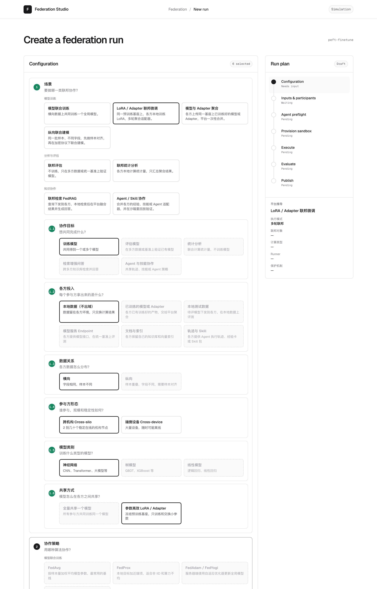
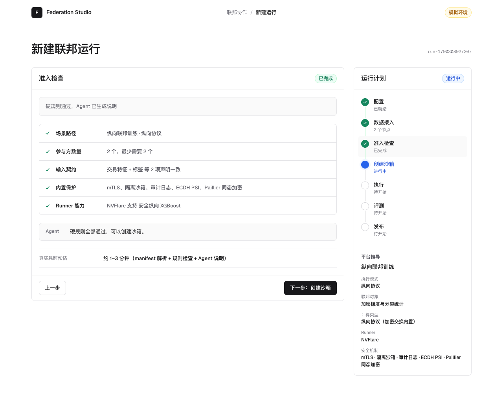

# Federation Studio

Federation Studio 是面向多种隐私协作任务的场景配置与运行控制台原型。平台不自己实现联邦算法，而是用一套统一的维度分层把联邦方法组织起来：用户逐层回答 8 个问题，落到一个可运行的场景和策略；平台推导执行模式、联邦对象、runner 和保护机制，再走完准入、沙箱、执行、评测和发布。

当前版本是 **0.2.0 前端原型**。维度分层、依赖规则、运行计划和七步流程都可以演示；输入接入、Agent 准入、沙箱、联邦执行、隐私计算、评测和发布都是前端模拟，尚未连接后端。



## 维度分层

| # | 维度 / 子项 | 回答的问题 |
|---|---|---|
| 1 | 场景 | 要做哪一类联邦协作（8 个场景），第一步先选 |
| 1.1 | 协作目标 | 想共同完成什么（训练、评估、统计、检索问答、Agent 协作） |
| 1.2 | 各方投入 | 每个参与方拿出来的是什么（本地数据、已训练产物、测试数据、Endpoint、索引、Skill） |
| 1.3 | 数据关系 | 各方数据怎么分布（横向、纵向），仅在投入为本地数据时可选 |
| 1.4 | 参与方形态 | 跨机构、端侧设备 |
| 1.5 | 模型类别 | 神经网络、树模型、线性模型，仅在训练模型时可选 |
| 1.6 | 共享方式 | 全量共享、LoRA；已训练产物时改问产物类型 |
| 2 | 协作策略 | 只有当前场景的策略可选 |
| 3 | 安全与信任 | 5 档保护预设，由计算类型和 runner 能力判断 |
| 4 | 场景参数 | 策略之外的可调项 |

只收录主流、实际用得多的方法，大模型 / Agent 相关的方法也保留。第一步先选场景（维度 1），子项 1.1–1.6 自动填好；子项在同一张卡片里、各自是独立的圆角卡片，没选场景时置灰。之后子项中会离开该场景的选项置灰，也不能取消；换场景直接点另一个，再点一次当前场景即取消。其他选项再点一次即取消。所有候选项始终展开，只剩一个选项时自动选中。完整设计见 [DIMENSIONS.md](./docs/DIMENSIONS.md)。



## 本地运行

需要 Node.js 20.19+ 或 22.12+。

```bash
cd app
npm install
npm run dev:demo
```

打开 <http://127.0.0.1:8880/>。

完整质量检查：

```bash
cd app
npm run check
```

## 项目状态

| 模块 | 状态 | 说明 |
|---|---|---|
| 维度分层与依赖规则 | 已完成（前端） | 4 个维度（场景含 6 个子项）、8 个场景、23 条策略、5 档保护预设 |
| 运行计划推导 | 已完成（前端） | FrontendRunPlan：执行模式、联邦对象、runner、执行位置 |
| 七步向导 | 已完成 | 左侧步骤内容，右侧时间轴与平台推导面板，桌面与移动端 |
| 输入与参与方接入 | 前端模拟 | 示例参与方；上传只记录文件名和大小 |
| Agent 准入 | 前端模拟 | 确定性规则 + 说明文案，未接规则服务或 LLM Agent |
| 沙箱、执行、评测 | 前端模拟 | 每个场景按自己的执行模式模拟，并显示真实耗时预估 |
| 发布 | 前端模拟 | 手动确认发布范围，不生成真实文件 |
| 后端、身份、权限、审计 | 未实现 | 分层确认后先做两个后端 demo |

## 文档导航

- [项目目标](./docs/GOAL.md)
- [配置维度设计](./docs/DIMENSIONS.md)
- [当前进展](./docs/PROGRESS.md)
- [系统架构](./docs/ARCHITECTURE.md)
- [运行流程](./docs/FLOW.md)
- [后端 demo 候选](./docs/MVP_SCENARIO.md)
- [开发说明](./docs/DEVELOPMENT.md)
- [关键设计决策](./docs/DECISIONS.md)
- [任务记录](./docs/HISTORY.md)

## 目录

```text
federation-studio/
├── app/                  React + TypeScript 前端
│   └── src/
│       ├── domain/       维度注册表、选择引擎、运行计划、状态机、模拟器
│       ├── state/        页面状态与模拟驱动
│       └── ui/           逐层配置、各步骤视图、时间轴
└── docs/                 产品、维度、架构、流程、进展和开发文档
```
