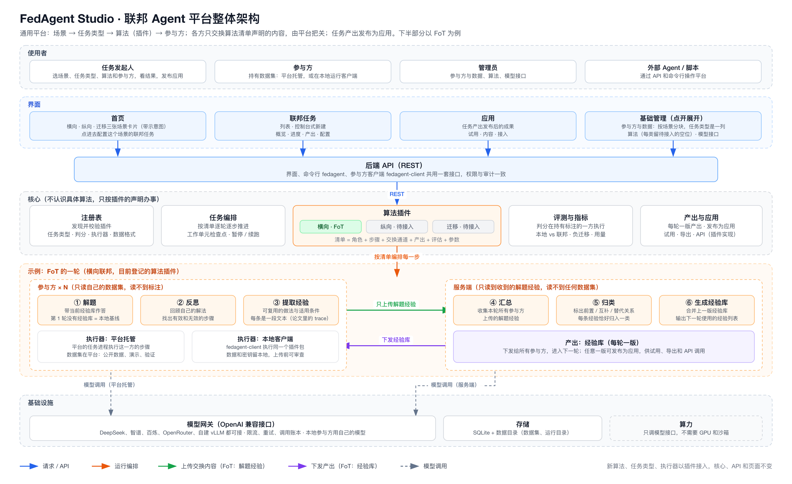

# 系统架构

最后复核：2026-10-02（T51：后端设计改为通用插件体系）
状态：目标架构。前端原型已完成；后端按本文设计，尚未实现。



图由 [agent-platform-design.gen.py](./agent-platform-design.gen.py) 生成：`python3 docs/agent-platform-design.gen.py docs/agent-platform-design.svg`，再用 `rsvg-convert -w 3200` 转 PNG。

## 1. 设计原则

- **核心不认识具体算法。** 除了三种场景的规则，任务类型、算法、判分方式、参与方的运行方式、数据格式、模型服务都是插件。核心只按插件的声明编排任务、转发消息、记账和存储；接入新插件不改核心、API 和页面。
- **数据流向写在清单里，由平台执行。** 每一步在哪一方运行、能读什么、哪些结果可以离开这一方，都写在算法清单里。平台按清单给每一步提供能力：服务端步骤拿不到任何数据集，算法步骤默认读不到标注，没有声明的通道发不出去。
- **同一份算法代码在两处运行。** 参与方的步骤由平台托管时在平台的任务进程里执行，参与方本地时在客户端执行，用的是同一个插件包。
- **可续跑、可核对。** 每一步拆成有固定编号的工作单元，结果写盘后才推进；模型调用按工作单元记账，续跑时已完成的调用不重复计费；配置、插件版本、提示词和数据都记哈希。
- **先单机，再扩展。** 一台服务器、SQLite、每个运行中的任务一个进程。数据库、文件存储和执行器都通过接口访问，以后要多机时换 PostgreSQL、对象存储或别的执行器，不改算法插件。

## 2. 分层与进程

```text
使用者（发起人、参与方、管理员、外部 Agent）
  └─ 界面 / 命令行 fedagent / 参与方客户端 fedagent-client
       └─ API（REST；界面、命令行、客户端共用一套接口、权限和审计）
            └─ 核心
                 ├─ 注册表：发现并校验插件（任务类型、算法、判分、执行器、数据格式、模型服务）
                 ├─ 任务编排：冻结配置，按算法清单逐轮、逐步推进，工作单元检查点
                 ├─ 执行器：平台托管、本地客户端；以后加隔离环境、参与方自己的 Agent 服务
                 ├─ 评测：按任务类型判分（在持有标注的一方执行），汇总指标
                 ├─ 产出与应用：产出版本、发布、试用、导出
                 ├─ 模型网关：OpenAI 兼容接口、限流、重试、调用账本
                 └─ 数据：数据集登记、检查、存取
            └─ 存储：SQLite（索引和状态）+ 数据目录（数据集、运行目录、产出）
```

| 进程 | 做什么 |
|---|---|
| api | REST 接口、参与方客户端的领取和提交、前端静态文件，同一个端口 |
| runner | 常驻：领取排队的任务，每个运行中的任务起一个子进程；处理暂停、继续、取消；子进程意外退出时从检查点重启 |
| 任务子进程 | 执行一个任务：平台托管的工作单元在进程内并发执行，本地参与方的工作单元放进队列，等客户端领取 |
| fedagent-client | 在参与方的环境里运行：领取本方的工作单元，本地执行，只提交声明可以离开的内容 |

api 和 runner 只通过数据库交流（任务状态、命令、工作单元），任何一个重启都不影响另一个。

## 3. 核心对象

| 对象 | 主要字段 | 说明 |
|---|---|---|
| 场景 Scenario | 角色规则、评估位置、是否要对齐样本 | 横向、纵向、迁移三种，平台内置（见 §6） |
| 任务类型 TaskType | 样本格式、标注字段、指标、判分方式 | 插件；决定数据格式和怎么评分 |
| 算法 Algorithm | 清单（角色、步骤、交换通道、产出、评估、参数、轮次）+ 代码 | 插件；每个算法只属于一个场景 |
| 参与方 Participant | 名称、机构、运行方式（平台托管 / 本地客户端）、状态 | 机构或节点，本身不绑定场景 |
| 数据集 Dataset | 持有方、场景、任务类型、格式、样本数、带标注的样本数、版本和内容哈希、存放位置 | 每份属于一个参与方；内容登记后不可改，改动就是新版本；本地数据集只有描述 |
| 模型接口 Endpoint | 地址、密钥（加密）、模型、并发上限、限速、单价 | 平台侧的模型调用都经过它 |
| 任务 Task | 冻结的配置、参与方快照、插件版本、各种哈希、状态、当前轮次和步骤 | 状态：排队中、运行中、已暂停、已完成、已取消 |
| 站点 Site | 任务里执行步骤的一方：参与方（角色、数据集、执行器、模型）或服务端 | 编排按站点分派工作 |
| 工作单元 WorkUnit | 任务、轮次、步骤、站点、单元编号、状态、租约、结果哈希 | 执行和续跑的最小单位：每条样本一个，或每个站点一个 |
| 消息 Message | 通道、轮次、步骤、发送方、接收方、大小、哈希、内容 | 跨站点的内容都经平台转发并留档，界面上的"通信记录"就是它 |
| 上报 Report | 站点、轮次、名称、值 | 离开一方的汇总值，例如答对数、带标注的样本数 |
| 产出版本 ArtifactVersion | 任务、生成于第几轮、类型、内容、插件版本 | 下发给清单声明的角色，进入下一轮 |
| 应用 App | 产出版本、名称，以及发布时记下的场景、任务类型、算法和插件版本 | 产出发布后的成果，可以试用、导出和通过 API 调用 |
| 调用记录 CallRecord | 任务、站点、步骤、工作单元、接口、模型、token、耗时、费用、请求哈希 | 模型调用账本，也是续跑时的缓存 |
| 事件 Event | 任务、时间、类型、内容 | 状态变化和进度，界面据此显示 |
| 用户 User | 账号、角色 | 发起人、管理员；先用单个管理员令牌（见 §15） |

## 4. 插件体系

### 4.1 插件种类

插件是 Python 包，通过包的 entry point 注册，平台启动时发现并校验。插件由平台管理员安装，是受信任的代码；不支持在界面上传插件代码。

| 种类 | entry point | 提供什么 | 现在有 |
|---|---|---|---|
| 算法 | `fedagent.algorithms` | 清单、每一步的代码、产出的用法（试用、导出） | FoT |
| 任务类型 | `fedagent.task_types` | 样本格式、标注字段、检查规则、指标 | 数学推理 |
| 判分 | `fedagent.graders` | 给一个预测和一条样本打分；声明要不要隔离环境 | 数学答案比对（论文兼容 / 严格） |
| 执行器 | `fedagent.executors` | 一方的工作单元在哪里、怎么执行 | 平台托管、本地客户端 |
| 数据格式 | `fedagent.formats` | 把文件读成一条条样本 | JSONL |
| 模型服务 | `fedagent.model_providers` | 不兼容 OpenAI 接口的服务的适配器 | 无（OpenAI 兼容是内置的） |

场景规则写在核心里（只有三种，见 §6）。

### 4.2 算法清单

清单（`manifest.yaml`）是算法的静态声明。注册表、配置校验、预估、进度页、算法页都只读清单，不运行算法代码。

| 字段 | 内容 |
|---|---|
| id、version、name、full_name、summary、source | 标识、版本、名称、一句话说明、论文和代码 |
| scenario、accepts | 所属场景、能处理的任务类型 |
| roles | 角色：每种角色几方、要什么数据、是否被评估。横向只有一种角色 |
| rounds | 轮次范围和默认值 |
| channels | 交换通道：谁发给谁、内容类型（文本、JSON、二进制）、预估量。只有声明过的通道能传内容 |
| artifact | 产出：类型（文本库、提示词、检索库、模型权重等）、名称、单位、下发给哪些角色 |
| steps | 每轮的步骤：在哪个角色或服务端执行（`at`）、按什么拆工作单元（`per`：每条样本 / 每个站点）、是否调用模型、读哪些通道、发哪些通道、是否生成产出、进度页记什么结果（指标、上传条数、收到条数、类别数、产出条数）、预估耗时和 token、失败重试上限 |
| evaluation | 从哪一步取预测来判分；基线怎么算（第 1 轮不带产出，或单独跑一次本地基线） |
| params | 参数：键、名称、控件、选项或范围、默认值、说明 |

前端现在的注册表（`app/src/domain/catalog.ts`）就是这份清单的前端版本，接入后端后改为从 API 读。FoT 的清单见 §20。

### 4.3 算法代码

插件继承 SDK 的 `Algorithm`，每一步写一个方法，用 `@step` 对应到清单里的步骤。草案：

```python
class Algorithm:
    manifest: Manifest                                   # 读自 manifest.yaml

    def validate(self, spec: TaskSpec) -> list[Issue]:   # 插件特有的检查；通用检查由平台做
        return []
    def estimate(self, spec: TaskSpec) -> Estimate:      # 默认按清单里每一步的预估计算，可以覆盖
        ...
    def plan(self, ctx: PlanContext, round: int) -> list[str]:   # 这一轮执行哪些步骤，默认按清单顺序
        ...
    def apply(self, artifact: Artifact | None, request: ApplyRequest, model: Model) -> ApplyResult:
        ...                                              # 使用产出（应用试用、API）；artifact 为 None 是不带产出的对照
    def export(self, artifact: Artifact, fmt: str) -> bytes:
        ...


class FoT(Algorithm):
    @step("solve")
    def solve(self, ctx: SiteStep) -> None:
        answer = ctx.model.chat(prompt_solve(ctx.item, ctx.artifact()))   # 第 1 轮没有产出
        ctx.keep("answer", answer)       # 留在本方，后面的步骤用
        ctx.predict(answer)              # 交给判分：在本方执行，只上报答对数

    @step("extract")
    def extract(self, ctx: SiteStep) -> None:
        reply = ctx.model.chat(prompt_extract(ctx.item, ctx.recall("answer"), ctx.recall("reflection")))
        for trace in parse_traces(reply):
            ctx.send("trace", trace)     # 只有发到声明过的通道的内容会离开本方

    @step("library")
    def library(self, ctx: ServerStep) -> None:
        traces = ctx.inbox("trace")      # 服务端只能读到收到的消息
        ctx.publish(build_library(ctx.model, traces, ctx.recall("profile"), ctx.artifact()))
```

### 4.4 每一步能用什么

平台按清单给每一步一个上下文，能力只有下面这些；清单没声明的，代码也拿不到。

| 能力 | 参与方步骤 | 服务端步骤 |
|---|---|---|
| `ctx.item` / `ctx.items()`：本方的样本 | 有，默认不含标注字段 | 没有 |
| `ctx.artifact()`：当前的产出版本 | 产出下发给本角色时有 | 有 |
| `ctx.inbox(通道)`：发给本方的消息 | 有 | 有 |
| `ctx.keep()` / `ctx.recall()`：本方私有的中间结果 | 有，只留在本方 | 有 |
| `ctx.send(通道, 内容)`：发消息 | 只能发这一步在清单里声明的通道 | 同左 |
| `ctx.predict(预测)`：交给判分 | 被评估的角色才有，在本方判分 | 没有 |
| `ctx.report(名称, 值)`：上报汇总值 | 有 | 有 |
| `ctx.publish(产出)`：生成产出版本 | 清单里声明了生成产出的步骤才有 | 同左 |
| `ctx.model`：这一方分配到的模型 | 平台托管走网关；本地客户端用参与方自己的模型 | 走网关 |
| `ctx.params`、`ctx.round`、`ctx.site`、`ctx.log` | 有 | 有 |

需要标注参与计算的算法（例如纵向里持有标注的发起方要计算损失），在清单里给那一步声明 `labels: true`，平台才把标注交给它，并记入审计。

### 4.5 任务类型与判分

```python
class TaskType:
    id: str                          # "math-reasoning"
    item_schema: type[BaseModel]     # 一条样本的格式：id、question、answer（可选）
    label_fields: tuple[str, ...]    # 标注字段 ("answer",)：算法步骤默认看不到
    metric: Metric                   # 指标名称，越大越好还是越小越好
    graders: list[str]               # 可用的判分方式，第一个是默认

    def check(self, rows) -> CheckReport: ...    # 和前端上传检查同一套规则


class Grader:
    id: str
    isolation: Literal["none", "sandbox"]        # 要执行代码的判分（例如编程题跑测试）标 sandbox
    def grade(self, prediction: str, item) -> Score: ...
```

判分在持有标注的一方执行：平台托管的在平台，本地参与方在客户端。离开这一方的只有汇总（答对数、带标注的样本数）。

### 4.6 版本

- 插件有版本号。任务创建时记下插件版本和代码哈希；运行中不换版本，续跑时版本不一致就拒绝，提示装回原版本或复制为新任务。
- 产出版本和应用都记下生成它的插件版本，试用和导出按这个版本解释产出。
- 本地客户端领取工作单元时检查插件版本，不一致时提示升级。

## 5. 扩展点：加一个新东西要做什么

| 要加的 | 要写的 | 不用改的 |
|---|---|---|
| 新算法（任何场景） | 一个算法插件包：清单、每一步的代码、试用和导出；用 SDK 的契约测试在小数据和假模型上跑通（见 §18） | 核心、API、已有页面。纵向、迁移的第一个算法接入时，要补那个场景的任务配置页 |
| 新任务类型 | 任务类型插件：样本格式、标注字段、检查规则、指标，以及至少一个判分方式；算法在 `accepts` 里声明支持后才能选 | 核心、已有算法 |
| 新判分方式 | 判分插件；要执行代码的标 `sandbox`，由隔离环境执行 | 任务类型以外的部分 |
| 新的参与方运行方式 | 执行器插件，例如参与方自己的 Agent 服务、隔离环境 | 算法、编排 |
| 新数据格式、存储 | 数据格式适配器（CSV、Parquet 等）；存储后端（对象存储等） | 算法、任务类型 |
| 新模型服务 | OpenAI 兼容的直接在界面登记接口；不兼容的写模型服务适配器 | 其他全部 |
| 新场景 | 核心里的场景规则 + 前端的配置页（很少发生） | 已有算法 |

## 6. 三种场景

场景决定角色、数据怎么对应、在哪里评估；具体做哪些步骤由算法声明。

| | 横向 | 纵向 | 迁移 |
|---|---|---|---|
| 角色 | 只有"参与方"一种，地位相同 | 发起方（持有问题和标注，一方）+ 数据提供方（一方以上） | 源方（已有经验）+ 目标方（新领域） |
| 数据 | 同一任务类型、同一样本格式，各方样本不同 | 同一批对象，各方掌握不同字段，都有对象 ID | 源方、目标方各自领域的数据，任务类型由算法声明 |
| 开始前 | 无 | 平台先对齐对象 ID，只用交集里的对象；用隐私集合求交（PSI），各方看不到对方不在交集里的 ID | 无 |
| 每轮交互 | 一般是各方 → 服务端 → 各方 | 可以按对象在各方之间多次往返 | 以源方 → 目标方为主 |
| 评估 | 每个参与方在自己的数据上评估 | 只在发起方评估合起来的结果 | 主要在目标方评估 |
| 产出下发 | 所有参与方 | 按算法声明 | 按算法声明，一般是目标方 |

- 跨站点的内容都经平台转发（星形），不支持参与方之间直连，这样每条消息都留档、可审计。需要加密的算法自己加密，平台只转发，并记录大小和哈希。
- 每一步是一道栅栏：所有站点完成这一步，才进入下一步。需要按对象多次往返的，在清单里写成多个步骤，或由插件的 `plan` 按需重复。不支持异步联邦（各方各跑各的），以后需要时在编排层加。

## 7. 任务编排

```text
草稿 → 校验 → 冻结 → 排队中 → 运行中（准备 → 第 1…N 轮 → 收尾）→ 已完成
                        已暂停 ↔ 运行中；运行中或已暂停 → 已取消
```

- **校验**：通用检查（场景、各角色的人数、每方一份数据集、数据集的场景和任务类型与任务一致、持有方在线、模型接口可用、轮次范围）加上插件自己的检查。
- **冻结**：配置、参与方和数据集快照、插件版本和代码哈希、提示词哈希（插件提供）、数据集内容哈希。之后改参与方和数据集，不影响已有任务。
- **准备**：场景要求的准备步骤，例如纵向的对象 ID 对齐；插件也可以声明自己的准备步骤。
- **每一轮**：按插件的 `plan` 取这一轮的步骤（默认按清单顺序）。每一步按清单拆成工作单元，交给各站点的执行器；全部完成后，把这一步发出的消息投给接收方，记下进度结果，再进入下一步。轮末记指标和产出版本。
- **检查点**：工作单元的结果写盘、并在数据库标为完成，才算完成。续跑时跳过已完成的单元；单元里已完成的模型调用直接从调用账本取结果，不重复计费。
- **暂停 / 继续 / 取消**：暂停时停掉任务子进程（正在执行的单元等一小段时间），收回本地客户端的租约；继续时起新进程，从检查点接着跑；取消就停在当前步骤，不能再继续。
- **失败**：
  - 模型调用失败，由网关按接口配置重试；
  - 工作单元失败，按清单的重试上限重试，仍失败就暂停任务并写明原因（例如"服务端汇总结果连续 5 次不合法"），修好后可以继续；
  - 任务子进程意外退出，runner 从检查点自动重启，连续 3 次失败就暂停；
  - 本地参与方超时（租约过期、没有心跳），先等待，超过任务设定的上限后暂停，并写明是哪一方。
- **费用上限**（可选）：调用账本累计超过任务设定的上限时暂停。
- **并发**：同时运行的任务数默认 1。任务内同时执行的工作单元不超过任务配置的并发数；模型调用还受每个接口的并发上限约束，由网关统一控制。

## 8. 执行器：参与方在哪里运行

| | 平台托管 | 本地客户端 |
|---|---|---|
| 谁执行这一方的步骤 | 任务子进程（进程内并发） | 参与方环境里的 `fedagent-client`，装同一个插件包 |
| 数据集 | 存在平台 | 留在本地，只登记描述 |
| 模型 | 经过平台的模型网关 | 参与方自己的模型和密钥 |
| 离开这一方的内容 | 平台运营方技术上能看到数据集，只适合公开数据和演示；服务端步骤仍然只读到交换的内容 | 只有声明过的通道里的消息和上报的汇总 |

本地客户端协议（通用，不认具体算法）：

1. **连接**：用平台签发、按参与方和任务授权、可以吊销的令牌连接；上报客户端版本、已装的插件，以及本地数据集的描述（样本数、带标注的样本数、格式哈希），不上传样本。
2. **领取**：领取本方待执行的工作单元，带租约；执行中定时心跳。
3. **输入**：取这一步需要的输入（发给本方的消息、当前产出版本）。
4. **执行**：在本地执行插件里这一步的代码，读本地数据，用自己的模型。
5. **审查**（可选，`--review`）：发出的消息在上传前逐条确认，也可以配置过滤规则。
6. **提交**：只提交消息和上报值；私有的中间结果留在本地。

以后要加的执行器：

- **隔离环境**：给要执行代码的步骤或判分用，每个工作单元起一个用完即删的隔离环境（gVisor、Firecracker 一类）。现在的算法不执行生成的代码，不需要。
- **参与方自己的 Agent 服务**：参与方不装客户端，提供一个 HTTPS 接口，平台把工作单元发过去。

## 9. 数据

- **登记**：数据集属于一个参与方，登记时选定场景和任务类型。平台托管的上传文件；本地的只登记描述，连上客户端后上报样本数。
- **检查**：按任务类型的样本格式逐行检查，和前端上传检查同一套规则，后端再查一次。
- **版本**：内容登记后不可改，重新上传就是新版本；任务冻结时记下内容哈希。
- **读取**：数据格式适配器把文件读成一条条样本（现在是 JSONL，以后 CSV、Parquet）；文件放在存储后端（现在是数据目录，以后可以换对象存储）。
- **试跑**：每份数据集按固定顺序取前 N 条。
- **标注**：只在持有方使用，算法步骤默认读不到（见 §4.4）。
- **纵向、迁移**：纵向数据集要指定对象 ID 字段，迁移数据集要标明领域；具体要求由场景规则和算法的 `roles` 声明。

## 10. 评测与指标

- **判分**：按任务类型的判分方式，在持有标注的一方执行。数学推理抽取 `\boxed{}` 里的答案，规范化后与标准答案比较，分论文兼容和严格两套口径。
- **指标**（每个被评估的站点、每一轮）：
  - 主要指标（数学推理是准确率）和带标注的样本数；
  - 宏平均（每方权重相同，与论文一致）；
  - 相对基线的变化；
  - 负迁移：最新一轮低于本方基线的站点数；
  - 交换量、产出大小、token 与费用。
- **基线**：由清单声明。第 1 轮不带产出的算法（例如 FoT），第 1 轮就是本地基线；否则平台在第 1 轮之前单独跑一次不带产出的评估。
- **评估位置**：由场景决定（见 §6）。

## 11. 产出与应用

- **产出版本**：生成产出的步骤每轮（或插件声明的轮次）生成一版，存进运行目录，下发给清单声明的角色。
- **发布为应用**：任意一版可以发布，同一版只发布一次。应用记下产出版本、场景、任务类型、算法和插件版本，来源任务删掉后仍在原来的类别里。
- **试用**：调用插件的 `apply`，同一个输入分别"带产出""不带产出"各跑一次，并排对比；输入带标注时自动判分。FoT 的做法是把整份经验库放进解题提示词。
- **导出**：调用插件的 `export`，格式由插件声明（FoT 与 `library_r{n}.json` 相同）。
- **API**：`POST /v1/apps/{id}/apply`，可以批量调用、同时对比。
- **来源追溯**：消息都留档，能查到一版产出用过哪些消息、这些消息来自哪些参与方。能精确到哪一层由算法决定：FoT 的经验由服务端按类别提炼，只能精确到类别。

## 12. 模型网关

- **接口**：内置 OpenAI 兼容客户端（httpx），覆盖大多数服务：DeepSeek、智谱、阿里云百炼、OpenRouter，以及自建的 vLLM。不兼容的服务写模型服务适配器。
- **登记**：地址、密钥（服务端加密保存，接口只能写入、不能读出）、模型列表、并发上限、限速、重试、超时、单价。任务里的模型引用默认是 `default`，可以给某些参与方单独指定。
- **调用账本**：每次调用记下任务、站点、步骤、工作单元、接口、模型、token、耗时、费用、请求哈希和结果。续跑时，同一个工作单元里的同一次调用（按调用顺序和请求哈希对应）直接取账本里的结果。
- **假模型**：内置一个确定性的假模型接口，按请求返回固定内容；开发、测试和演示用，离线、不花钱。
- **本地参与方**：用自己的模型，不经过网关；token 用量由客户端上报，仅供参考。
- **网络现状**（2026-10-02 从实验室服务器测试）：OpenAI、Gemini 的官方接口因地区限制被拒绝；DeepSeek、智谱、阿里云百炼、OpenRouter 可以访问。服务器有 8 张 96GB GPU，与他人共用，以后可以自建 vLLM 作为一个接口。

## 13. API 草案

```text
# 注册表（前端按它生成页面）
GET  /v1/scenarios             GET  /v1/task-types          GET /v1/algorithms?scenario=&task_type=
GET  /v1/algorithms/{id}       （清单、版本、参数定义）

# 参与方、数据、模型接口
GET/POST /v1/participants                  GET/PATCH/DELETE /v1/participants/{id}
POST /v1/participants/{id}/client-tokens   DELETE /v1/client-tokens/{id}
GET/POST /v1/datasets?participant=&scenario=&task_type=       GET/DELETE /v1/datasets/{id}
POST /v1/datasets/check                    （按任务类型检查文件，不保存）
GET/POST /v1/endpoints                     PATCH/DELETE /v1/endpoints/{id}       POST /v1/endpoints/{id}/test

# 联邦任务
POST /v1/tasks/validate                    POST /v1/tasks/estimate               POST /v1/tasks
GET  /v1/tasks?scenario=&task_type=&status=                       GET /v1/tasks/{id}
POST /v1/tasks/{id}/pause | resume | cancel
GET  /v1/tasks/{id}/progress               （轮次 × 步骤 × 站点的状态和结果）
GET  /v1/tasks/{id}/metrics                GET /v1/tasks/{id}/messages?round=&step=&site=   （通信记录）
GET  /v1/tasks/{id}/artifacts              GET /v1/tasks/{id}/artifacts/{version}
GET  /v1/tasks/{id}/events                 （SSE；先用轮询）

# 应用
POST /v1/apps                              GET /v1/apps?scenario=&task_type=     GET/PATCH/DELETE /v1/apps/{id}
POST /v1/apps/{id}/apply                   GET /v1/apps/{id}/export?format=

# 参与方客户端
POST /v1/client/hello                      POST /v1/client/units/claim
GET  /v1/client/units/{id}/inputs          POST /v1/client/units/{id}/heartbeat | complete | fail
```

- FastAPI 生成 OpenAPI 定义，前端用 openapi-typescript 生成类型；接口一改，前端类型检查就会报错。
- 命令行 `fedagent`（如 `fedagent run -f task.yaml`、`fedagent status <task>`、`fedagent apps apply <id>`）调用同一套接口。

## 14. 存储

- **数据库**：SQLAlchemy 2 + Alembic 迁移，默认 SQLite（WAL 模式），存索引和状态：参与方、数据集、接口、任务、站点、工作单元、消息索引、产出版本、应用、调用记录、事件。换 PostgreSQL 只改连接串。
- **数据目录**（和代码分开放，部署时不覆盖）：

```text
<data>/
├── fedagent.db
├── datasets/<数据集 id>/<版本>/        平台托管数据集的样本文件
└── runs/<任务 id>/
    ├── task.json                      冻结的配置、参与方快照、插件版本、各种哈希
    ├── units/r{n}/<步骤>/<站点>.jsonl   工作单元结果（检查点；本地参与方的私有结果不在这里）
    ├── messages/r{n}/<步骤>.jsonl       跨站点的消息（通信记录）
    ├── artifacts/v{n}.json             产出版本
    ├── calls.jsonl                     调用账本
    ├── events.jsonl                    事件
    ├── metrics.json                    指标
    └── plugin/                         插件自己的文件（FoT 按复现器的格式写，便于核对）
```

## 15. 安全与隐私

- **数据流向**：由清单声明、平台执行（见 §4.4）。服务端步骤读不到数据集，算法步骤默认读不到标注，没声明的通道发不出去，本地参与方只提交消息和上报值。
- **平台托管的边界**：平台运营方技术上能看到托管的数据集，只用于公开数据和演示；真实的跨机构联邦用本地客户端。
- **交换内容的风险**：
  - 文本消息可能带出样本细节：本地客户端支持上传前过滤和逐条确认；
  - 其他参与方的消息可能夹带指令（提示词注入），或者故意给出坏经验（投毒）：算法把收到的内容当作数据而不是指令；消息都留档、能追溯到来源，可以去掉某一方的消息后重算。
- **令牌和密钥**：参与方客户端的令牌按参与方和任务授权、可以吊销；模型密钥加密保存，接口只能写入、不能读出；本地参与方的密钥留在本地。
- **审计**：每个任务记录配置、插件版本、提示词、数据的哈希，以及调用账本和消息记录；把标注交给算法步骤（`labels: true`）也记入审计。
- **身份与权限**：先用单个管理员令牌（平台只在 Tailscale 内网访问）；之后加发起人、管理员两种角色，再接统一登录。
- **插件**：管理员安装的受信任代码；要执行模型生成的代码时，必须放在隔离环境里（见 §8）。

## 16. 前端对接

- 注册表改为从 API 读（场景、任务类型、算法清单），替换 `catalog.ts` 里的常量；页面已经按清单字段生成，不用改。
- 状态改为读 API，用 TanStack Query 轮询运行中的任务（以后换 SSE）；预估改为调用 `POST /v1/tasks/estimate`。
- 任务多一个"排队中"的状态；其他状态、配置校验、页面结构不变。
- 删掉 `domain/sample.ts` 和 `tick` 模拟；演示改用假模型接口跑真实流程。
- 类型由后端的 OpenAPI 生成（见 §13）。

前端现有的结构和界面规范见 [DEVELOPMENT.md](./DEVELOPMENT.md)。

## 17. 代码结构

```text
server/                        uv workspace，虚拟环境在 server/.venv
├── pyproject.toml
├── fedagent/                  平台核心
│   ├── api/                   FastAPI 路由，按资源分文件
│   ├── core/                  核心对象和场景规则
│   ├── registry/              插件发现、清单校验
│   ├── engine/                编排：轮次、步骤、工作单元、检查点、消息投递
│   ├── runner/                任务进程管理：排队、启动、暂停、继续、取消、重启
│   ├── executors/             平台托管、本地客户端（以后：隔离环境、Agent 服务）
│   ├── gateway/               模型网关：OpenAI 兼容客户端、限流、重试、调用账本、假模型
│   ├── data/                  数据集登记、检查、格式适配器、存储后端
│   └── store/                 数据库模型、Alembic 迁移、运行目录
├── sdk/                       插件开发包 fedagent-sdk：基类、上下文、契约测试工具
├── plugins/
│   ├── fot/                   FoT 算法插件：manifest.yaml、提示词、六个步骤、apply、export
│   └── math_reasoning/        数学推理任务类型和判分
├── client/                    fedagent-client：本地参与方客户端
└── tests/
```

插件和客户端只依赖 `fedagent-sdk`，不依赖平台核心；客户端装上 SDK 和需要的插件，就能执行参与方的步骤。

## 18. 开发、测试与部署

流程：本地实现 → 本地测试通过 → 用真实接口小规模试跑 → 部署到实验室服务器 → 在服务器上冒烟测试。

**本地开发**：

- Python 3.12，uv 在项目内建虚拟环境（`server/.venv`），不全局安装；
- SQLite 和数据目录放在本地；
- 默认用假模型，需要时登记真实接口；
- 前端开发服务器把 `/v1` 代理到本地 API。

**测试**：

| 层次 | 内容 |
|---|---|
| 单元测试 | 核心对象、场景规则、编排（用假插件和假执行器）、网关（限流、重试、账本、缓存）、数据检查 |
| 插件契约测试 | SDK 提供：在小数据和假模型上把一个算法跑完所有轮次，并检查只用了声明的通道、服务端步骤没读数据集、算法步骤没读到标注（除非声明）、产出按清单生成、中途杀掉进程再续跑结果和不中断时一致 |
| FoT 回归 | 同一配置下 dry-run 的产物与复现器一致；复现器的命令行和测试保留 |
| API 测试 | 覆盖每个接口，包括客户端的领取、心跳和提交 |
| 端到端 | 前端接本地后端，用假模型从创建任务跑到发布应用；再起一个本地客户端进程，跑一次本地参与方 |
| 真实模型冒烟 | 部署前用真实接口跑试跑模式（每份 1–2 条、2 轮），确认提示词、判分和费用记账 |

**部署到实验室服务器**（只在 Tailscale 内网访问）：

服务器没有 Docker 和 sudo，所以不用容器，全部是用户进程，放在一个目录里，删掉这个目录就干净了：

```text
~/fedagent-studio/
├── bin/uv           uv 本身（不装到系统）
├── python/          uv 下载的 Python 3.12
├── dist/            前端静态文件（现在已经在用）
├── server/          后端代码，虚拟环境在 server/.venv
├── data/            数据库、数据集、运行目录（部署不覆盖）
└── logs/  run/      日志和进程号
```

- `deploy/deploy.sh` 扩展为：本地跑完检查 → 构建前端 → 同步代码 → `uv sync --frozen` → 数据库迁移 → 重启 api 和 runner → 健康检查（`/healthz`）。
- api 只监听 Tailscale 地址，前端静态文件也由它提供，同一个端口（8880）。
- 进程用 `setsid nohup` 启动并记下进程号，和现在的 `serve.sh` 一样。服务器重启后要重新运行启动脚本；能不能用 crontab 的 `@reboot` 自动拉起，部署时确认。
- 资源：一台普通 CPU 服务器就够（4 核 8 GB 起）。平台不需要 GPU（模型调用走接口；自建模型服务另算）。

## 19. 技术选型

| 部分 | 选型 | 理由 |
|---|---|---|
| 后端 | Python 3.12 + FastAPI + Pydantic 2 | FoT 复现器是 Python；FastAPI 自带 OpenAPI，前端可以据此生成类型 |
| 数据库 | SQLAlchemy 2 + Alembic，SQLite（WAL） | 单机够用；换 PostgreSQL 只改连接串 |
| 任务执行 | 自写的 runner，每个任务一个子进程 | 任务是长时间、有状态的多轮流程，要逐单元续跑、暂停和记账；一个任务出错不影响别的 |
| 模型调用 | httpx，OpenAI 兼容接口 | 复现器唯一的依赖就是 httpx；多数服务都兼容这个接口 |
| 插件 | Python entry points + YAML 清单 | Python 打包的标准做法；清单可以单独校验，前端直接用 |
| 环境与打包 | uv（workspace） | 依赖锁定；虚拟环境放在项目目录里 |
| 测试与检查 | pytest、ruff、pyright | 主流 |
| 前端 | React 19 + TypeScript + Vite、ECharts；接后端后加 TanStack Query、openapi-typescript | 沿用现有前端 |
| 部署 | 用户进程 + 部署脚本 | 实验室服务器没有 Docker 和 sudo |

没采用的方案和理由见 [DECISIONS.md](./DECISIONS.md) D47：Celery、RQ 一类任务队列；Temporal、Prefect 一类工作流引擎；Flower 一类联邦学习框架；Docker Compose 和 K8s。

## 20. FoT 插件

FoT 是第一个算法插件（横向，任务类型：数学推理）。来源是已审计的论文复现器 `run_paper_reproduction.py`（8 个客户端、300 题、Prompt 1–5、JSONL 检查点、哈希审计），拆成插件的六个步骤。行为保持不变，只改三处：

1. 数据集从固定的 8 个改为任务里选中的那些；
2. `answer` 可以缺省（这一方不计准确率）；
3. 进度和结果交给平台的编排，而不只打印到终端。

复现器的命令行入口和 `test_reproduction.py` 保留，作为回归测试。它对应上游 FoT 的两个抽象接口：`LocalReasoningClient`（`local_step_1/2/3`）是参与方的三步，`GlobalReasoningServer`（`global_step_1/2/3`）是服务端的三步。

清单要点（预估字段省略）：

```yaml
id: fot
scenario: horizontal
accepts: [math-reasoning]
roles: { participant: { min: 2, evaluated: true } }
rounds: { min: 2, max: 6, default: 3 }
channels:
  trace: { from: participant, to: server, kind: text, label: 解题经验 }
artifact: { kind: text-library, name: 经验库, unit: 条经验, to: [participant] }
evaluation: { step: solve, baseline: round-1 }
steps:
  - { id: solve,   label: 解题,       at: participant, per: item, model: true, result: metric }
  - { id: reflect, label: 反思,       at: participant, per: item, model: true }
  - { id: extract, label: 提取经验,   at: participant, per: item, model: true, sends: [trace], result: uploads }
  - { id: collect, label: 汇总,       at: server, per: site, reads: [trace], result: received }
  - { id: profile, label: 归类,       at: server, per: site, model: true, result: groups }
  - { id: library, label: 生成经验库, at: server, per: site, model: true, publishes: true, result: output }
```

每轮 6 步：

| 步骤 | 在哪 | 读 | 结果 |
|---|---|---|---|
| ① 解题 | 参与方 | 题目（不含答案）+ 当前经验库（第 1 轮没有） | 解答：留在本方；交给判分，只上报答对数 |
| ② 反思 | 参与方 | 题目 + 本方解答 | 反思：留在本方 |
| ③ 提取经验 | 参与方 | 题目 + 解答 + 反思 | 解题经验（论文里的 trace）：发到 `trace` 通道 |
| ④ 汇总 | 服务端 | 本轮收到的全部 trace | trace 集合 |
| ⑤ 归类 | 服务端 | trace 集合 | 类别（每条经验恰好归入一类）+ 关系（前置、互补、替代等） |
| ⑥ 生成经验库 | 服务端 | trace 集合 + 类别 + 上一版经验库 | 下一轮的经验库（产出版本） |

标准答案只用于判分，不进入以上任何一步。服务端每轮一次读完所有 trace，所以服务端模型需要长上下文。

平台参数与复现器参数一一对应：

| 平台参数 | 复现器参数 | 平台默认 | 说明 |
|---|---|---|---|
| 轮次 | `--rounds` | 3 | 至少 2 轮 |
| 试跑每份前 N 题 | `--cap` | 5（试跑） | 正式运行不设 |
| 参与方模型、分别指定 | `--client-model`、`--client-model-secondary` | 统一一个 | 平台扩展为每个参与方都可以单独指定 |
| 服务端模型 | `--server-model` | — | 需要长上下文 |
| 经验库条数 | `--insight-target` | paper-auto | 另有 author-formula、11、37 |
| 经验提取量 | `--trace-density-mode` | native | 另有 paper-gemini |
| 每题最多 trace 数 | `--max-traces-per-item` | 不限 | |
| 汇总重试上限 | `--aggregation-max-attempts` | 5 | 复现器默认 0（一直重试到合法），平台改为有限次，超过后暂停任务 |
| 随机种子、并发数 | `--seed`、`--workers` | 0、8 | 复现器的并发是所有参与方共用的线程池；平台里是任务内同时执行的工作单元上限，同时受接口的并发上限约束 |

- **插件文件**：平台托管的参与方，FoT 插件在运行目录的 `plugin/` 下按复现器的格式写 `solve_r{n}.jsonl`、`reflection_r{n}.jsonl`、`trace_r{n}.jsonl`、`aggregation_r{n}_profile.json`、`aggregation_r{n}.json`、`library_r{n+1}.json`，便于和复现器逐个核对；本地参与方的解答和反思留在参与方本地。
- **试用和导出**：带库时按解题提示词（Prompt 1）把整份经验库放进上下文，不带库时只给题目；导出与 `library_r{n}.json` 同格式（经验名 → 描述）。
- **成本**：完整复现一次约 2,700 次参与方调用，每轮另有至少 2 次服务端调用，token 估计在千万量级；默认先试跑。
- **界面用语**：论文里的 trace 在界面上叫"解题经验"，insight / insight library 叫"经验 / 经验库"，profile 这一步叫"归类"；代码、命令行参数和检查点文件沿用论文的英文名（trace、insight、library）。
- **审计**：记录上游代码版本（dixiyao/FoT @ b02753c）。

## 21. 待定

- 纵向和迁移采用哪些算法（暂不定）；第一个算法接入时，按 §6 补齐角色、对齐和配置页。
- 本地参与方超时：默认等多久；是否允许跳过某一方继续（由算法声明）。
- 用哪个模型服务：OpenAI、Gemini 的官方接口从服务器访问不了；可选 DeepSeek（论文用过）、智谱、阿里云百炼、OpenRouter，或者在实验室 GPU 上自建 vLLM。
- 服务器重启后自动拉起：crontab 能不能用，部署时确认。
- 身份与权限：先用单个管理员令牌，之后再定。
