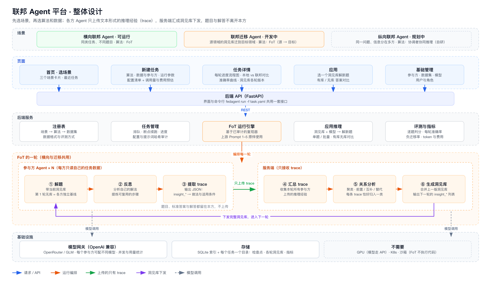

# 联邦 Agent 平台改版方案（待确认）

更新时间：2026-09-28（T32）
状态：方案待确认，代码尚未改动



图由 [agent-platform-design.gen.py](./agent-platform-design.gen.py) 生成：`python3 docs/agent-platform-design.gen.py docs/agent-platform-design.svg`，再用 `rsvg-convert -w 3200` 转 PNG。

## 1. 定位

平台只做联邦 Agent：多个参与方的 Agent 一起变强，但题目、答案和原始数据都不交出去。每一方的 Agent 在自己的任务上解题、反思，把推理经验提炼成文本（trace）上传。服务端把各方的经验归类、合并成一份洞见库（insight library），再下发给所有参与方，用于下一轮。整个过程不传模型参数，不需要梯度，也不需要标注。

第一个算法是 FoT（Federation over Text，[arXiv:2604.16778](https://arxiv.org/abs/2604.16778)，上游仓库 <https://github.com/dixiyao/FoT>）。原来的 7 个配置维度、4 个训练 / 统计场景和组队流程都不再需要，改版时全部去掉（见第 9 节）。

## 2. 主流程

```text
选场景 → 选算法 → 选数据（每份数据由一个参与方 Agent 负责）→ 设参数 → 试跑 / 正式运行
      → 任务详情：每轮进度、本地 vs 联邦、洞见库各轮版本
      → 发布洞见库 → 应用：用它解新题
```

## 3. 场景、算法与数据

| 场景 | 含义 | 算法 | 数据 | 第一版 |
|---|---|---|---|---|
| 横向联邦 Agent | 各方做同一类任务，但题目不同，例如 8 个数学题库各由一方负责 | FoT | 内置 8 个数学数据集（共 300 题）；也可上传同格式的题库 | 可运行 |
| 联邦迁移 Agent | 已有参与方沉淀的洞见库，交给另一个领域的 Agent 使用；目标方也可以继续参与后续轮次 | FoT（源 → 目标） | 源：内置数学数据集，或已完成任务的洞见库；目标：上传的其他领域题库 | 开发中 |
| 纵向联邦 Agent | 同一个问题，回答它所需的信息分散在多方 | 协调者协同推理（自研，待设计） | 需要按多方拆分信息的新数据 | 规划中（置灰） |

选场景后只列出该场景可用的算法；选算法后只列出格式和评分方式匹配的数据集。算法统一按"参与方三步 + 服务端三步"的接口登记（对应上游的 `LocalReasoningClient` 和 `GlobalReasoningServer`），以后加新算法不用改页面。

FoT 有几条特性，直接决定了产品设计：

- **没有标准答案也能参与。** 解题、反思、提取 trace 都只用到题目和本方自己的解答；标准答案只用来算准确率。所以只有题目的数据集也能参与联邦，只是这一方不显示准确率。
- **第 1 轮就是"本地"基线。** 第 1 轮还没有洞见库，各方独立作答，正好对应老 demo 的"本地建模"；最后一轮对应"联邦建模"。
- **每轮末尾都生成新洞见库。** 3 轮的任务会产出三版洞见库（供第 2、3、4 轮使用），最后一版就是可以发布的成果。
- **服务端每轮一次读完所有 trace。** 服务端模型需要长上下文。
- **不执行代码。** 数学题按答案判分，不需要沙箱。以后加编程题时，判分才需要隔离环境。

内置数据集（来自复现包）：

| 数据集 | 题数 |
|---|---|
| AIME24 | 30 |
| AIME25 | 30 |
| AMC | 46 |
| CCEE | 44 |
| CNMO | 18 |
| WLPMC | 11 |
| V202412Hard | 21 |
| V202505Hard | 100 |

数据格式为 JSONL，每行 `{"id", "question", "answer"}`，其中 `answer` 可选；另外登记领域和评分方式。第一版的评分方式是数学答案（抽取 `\boxed{}` 后规范化比较，分论文兼容和严格两套口径），后续再加选择题。

## 4. 参考老 demo（TrustFLAIR）

保留老 demo 的信息架构（首页 → 任务 → 应用 → 基础管理）和"本地 vs 联邦"对比；FATE 的建模指标和手动命令行操作不再需要。

| 老 demo | 新平台 |
|---|---|
| 首页：4 个领域卡片 | 首页：3 个场景卡片 + 最近任务 |
| 任务：本地建模 vs 联邦建模 | 任务详情：第 1 轮（各方独立）vs 最后一轮（带洞见库），按参与方和平均值对比 |
| 每轮准确率、损失曲线 | 每轮准确率曲线（每个参与方 + 平均）、每轮 token 用量 |
| 训练得分表（每轮 AUC、KS） | 每轮明细：各方准确率、上传的 trace 数、洞见库条数、token |
| 评估得分、混淆矩阵、ROC / KS / Lift / Gain | 不适用。换成逐题明细和负迁移率（成绩低于本方第 1 轮的参与方占比） |
| 应用：选模型、填特征、单次预测 | 应用：选一个已发布的洞见库，输入新问题，"不带库 / 带库"两栏对比；批量上传后给出准确率 |
| 参与方管理：名称、数据条数、算法类型、领域、状态、简介 | 参与方 Agent 管理：名称、所属机构、领域、数据集与题数、使用的模型、状态、简介 |
| 后台手动 `flow table upload`、`flow job submit`，再到 FATEBoard 看 DAG | 全部在界面上完成；每轮 6 步的进度直接显示在任务详情；命令行与界面共用一套 API |
| FATE + Docker 集群 | 不需要。FoT 只调用模型 API |

## 5. 页面

### 首页

- 3 个场景卡片：状态（可运行 / 开发中 / 规划中）、一句话说明、可用算法。
- 最近任务：名称、场景、状态、当前轮次、平均准确率变化。

### 新建任务（5 步）

1. **场景**：横向 / 迁移；纵向置灰。
2. **算法**：该场景可用的算法卡片。以 FoT 为例：共享什么、不共享什么、论文链接、提示词版本。
3. **数据**：可用数据集列表（领域、题数、是否带答案、评分方式、来源）。勾选即加入，每份数据由一个参与方 Agent 负责；横向至少 2 份。迁移场景分"源域"和"目标域"两组。
4. **参数**：推荐值已预填，常用项放在前面，其余收进"高级"。
5. **确认**：配置清单、调用次数（精确计算）、token 与费用预估、预计时长。可以先"试跑"，再"正式运行"。

也可以从模板开始：选"论文复现 · 数学 8 方"会一键填好数据和参数。

| 参数 | 默认 | 说明 |
|---|---|---|
| 轮次 | 3 | 论文设置；至少 2 轮才有联邦效果 |
| 参与方模型 | 统一一个 | 可给每个参与方单独指定（复现器支持 8 方按 4 + 4 用两个模型） |
| 服务端模型 | 需长上下文 | 负责关系分析和生成洞见库 |
| 每个数据集题数 | 全部 | 试跑时只取前 N 题 |
| 洞见库条数（高级） | 论文自动 | 另有作者公式、固定 11、固定 37 |
| trace 密度（高级） | 原生 | 可按论文 Gemini 的 trace 密度校准 |
| 每题最多 trace 数（高级） | 不限 | 复现器的消融选项 |
| 汇总重试上限（高级） | 5 次 | 超过后任务暂停并提示；复现器原设置为 0，即一直重试到结果合法 |
| 随机种子、并发数（高级） | 0、8 | |

### 任务详情

- 头部：名称、场景、算法、状态；暂停 / 继续 / 取消 / 复制为新任务 / 导出。
- 每轮进度：① 解题 ② 反思 ③ 提取 trace ④ 汇总 ⑤ 关系分析 ⑥ 生成洞见库。前三步按参与方显示进度；失败的条目从检查点续跑。
- 本地 vs 联邦：每个参与方第 1 轮与最新一轮的准确率及变化、平均值、负迁移率。
- 曲线：每轮准确率（每方 + 平均）、每轮 token。
- 洞见库：各轮版本、与上一版的差异、分类，以及每条洞见来自哪些参与方的 trace；可"发布到应用"。
- 逐题明细：按参与方、轮次、对错筛选，查看题目、解答、反思和提取出的 trace。
- 审计：配置快照与哈希、提示词哈希、所用模型、token 用量、错误与重试。

### 应用

- 选一个已发布的洞见库和模型。
- 单题：输入问题，"不带库 / 带库"两栏并排显示答案，并列出本次放进上下文的洞见库。
- 批量：上传带答案的题库，给出两种方式各自的准确率。批量模式也是迁移场景的第一步。

### 基础管理

- 参与方 Agent：内置 8 个（每个数学数据集一个，标"示例"），可新建、改名、换模型。
- 数据集：内置 + 上传；上传时检查格式（`id`、`question` 必填，`answer` 可选）和评分方式。
- 模型：OpenAI 兼容接口（OpenRouter、GLM 等），填接口地址和密钥（只存在服务端）；可测试连通，设置并发上限和单价（用于费用预估）。
- 用户与角色：管理员、成员。

## 6. 数据模型

| 对象 | 主要字段 |
|---|---|
| 场景 Scenario | id、名称、状态、说明、可用算法 |
| 算法 Algorithm | id、名称、支持的场景、参数定义与默认值、提示词版本（哈希） |
| 数据集 Dataset | id、名称、领域、题数、是否带答案、评分方式、来源（内置 / 上传） |
| 参与方 Participant | id、名称、所属机构、简介、数据集、模型、状态 |
| 任务 Task | id、名称、场景、算法、参与方、服务端模型、参数、状态（草稿 / 排队 / 运行中 / 已暂停 / 失败 / 已完成）、配置哈希、运行目录 |
| 洞见库 InsightLibrary | 任务、轮次、洞见列表（文本、分类、来源参与方）、是否已发布 |
| 应用记录 Application | 洞见库、模型、问题、带库 / 不带库的答案、是否正确 |
| 模型接口 ModelEndpoint | 名称、接口地址、密钥（服务端加密保存）、模型列表、并发上限、单价 |
| 用户 User | 账号、角色 |

每轮的进度和结果不另建表，直接读任务运行目录里的检查点文件（`solve_r{n}.jsonl`、`reflection_r{n}.jsonl`、`trace_r{n}.jsonl`、`aggregation_r{n}.json`、`library_r{n+1}.json`、`metrics.json`），格式与复现器一致。

## 7. 后端

```text
federation-studio/
├── app/                  前端（保留 React + TypeScript + Vite，页面重写）
├── server/               后端（Python 3.11+，uv 管理，虚拟环境在 server/.venv）
│   ├── fedagent/
│   │   ├── api/          FastAPI 路由
│   │   ├── registry/     场景、算法、数据集、评分方式
│   │   ├── engine/fot/   FoT 引擎：提示词、参与方三步、服务端三步、判分、指标、检查点
│   │   ├── tasks/        排队、启动 / 暂停 / 续跑、进度
│   │   ├── gateway/      模型网关（OpenAI 兼容）
│   │   └── store/        SQLite 与运行目录
│   ├── data/             内置数据集
│   └── tests/
├── third_party/fot/      上游快照（只读，记录来源与哈希）
└── docs/
```

- **FoT 引擎**：把已审计的 `run_paper_reproduction.py` 拆成模块，行为不变：上游 Prompt 1–5 原样使用，JSONL 检查点续跑，配置、提示词和数据都做哈希审计。改动只有三处：
  - 数据集从固定的 8 个改成任务里选中的那些；
  - `answer` 可以缺省；
  - 进度和结果通过函数返回给任务管理，而不只打印到终端。

  复现包的 `test_reproduction.py` 保留为回归测试，原命令行入口也保留，论文复现命令照常可用。
- **任务管理**：每个任务在独立的后台进程里运行引擎，界面通过 API 读检查点显示进度。暂停就是停掉进程，继续就是按同一配置重启，已完成的调用不会重复。同时运行的任务数默认 1，因为瓶颈在模型接口的限流。
- **模型网关**：统一的 OpenAI 兼容客户端（httpx）。每个接口单独配置密钥、并发上限、重试和单价，每次调用都记录 token 用量。参与方和服务端可以用不同的接口和模型。
- **应用推理**：带洞见库用 Prompt 1，不带库则直接解题，各解一次，再按数据集的评分方式判分。
- **存储**：SQLite 存索引（任务、参与方、数据集、洞见库、应用记录），每个任务一个运行目录存检查点。
- **命令行**：`fedagent run -f task.yaml`、`fedagent status <task>` 等，调用同一套 API，在界面之后做。

API 草案：

```text
GET  /scenarios            GET  /algorithms?scenario=     GET  /datasets?algorithm=
POST /datasets（上传）     GET  /participants              POST /participants
POST /tasks/estimate       POST /tasks                     POST /tasks/{id}/start | pause | resume | cancel
GET  /tasks/{id}           GET  /tasks/{id}/metrics        GET  /tasks/{id}/libraries
GET  /tasks/{id}/items     POST /libraries/{id}/publish    POST /apply        POST /apply/batch
GET  /models               POST /models                    POST /models/{id}/test
```

前端保留 React + TypeScript + Vite 和现有的检查脚本；图表用 ECharts，接口数据用 TanStack Query 轮询。

## 8. 部署与资源

- 一台普通 CPU 服务器即可（4 核 8 GB 起），不需要 GPU，因为模型调用都走外部接口。
- 服务器要能访问 OpenRouter / GLM 的接口；磁盘主要存运行记录（JSONL 文本）。
- 不需要 K8s、沙箱，也不需要 KVM。之前要等实验室服务器确认 KVM，现在不用了。
- 主要成本是模型调用费。

## 9. 去掉与保留

**去掉**

- 前端：
  - 7 个维度与配置引擎（`taxonomy`、`dimensions`、`selection`、`plan`）；
  - 项目与组队（`project`）；
  - 七步状态机与模拟器（`run`、`simulator`、`inputs`、`demo`）；
  - 演示数据与本地保存（`seed`、`simulation`、`persistence`）；
  - 工作台、新建项目、项目详情、邀请等页面，以及相应的测试。
- 场景与流程：
  - 横向联邦训练（Flower）、纵向联邦训练、联邦统计分析、Agent 记忆联邦；
  - 发起 + 邀请与组织内部组队、节点交付；
  - 准入、创建环境、交付的模拟。
- 目标架构：K8s、Temporal、OPA、microVM / gVisor 沙箱、MCP，以及平台内部 Agent 层（Pydantic AI）。
- 文档：DIMENSIONS、FLOW、MVP_SCENARIO、旧 ARCHITECTURE、两张旧架构图和旧截图；GOAL、README、PROGRESS 重写。

**保留**

- 仓库、前端工具链（Vite、TypeScript、ESLint、Vitest、`npm run check`）、设计 token 和基础样式、中文文案规范。
- 文档结构（GOAL / DECISIONS / HISTORY / PROGRESS）。DECISIONS 和 HISTORY 写明哪些决定被废弃、为什么；删掉的代码留在 git 历史里。
- "模型走我方 OpenAI 兼容接口（OpenRouter / GLM）"这一决定，落实为模型网关。

## 10. 分阶段

| 阶段 | 内容 | 完成标志 |
|---|---|---|
| 0 清理 | 删除第 9 节所列内容；建好前后端骨架（uv 虚拟环境在 `server/.venv`） | `npm run check` 与后端测试通过 |
| 1 横向跑通 | FoT 引擎、8 个内置数据集、模型网关，任务的创建 / 运行 / 进度 / 指标；首页、新建任务、任务详情 | 同一配置下 dry-run 的产物与复现器命令行一致；从界面发起的真实试跑能跑完并给出指标 |
| 2 应用与管理 | 洞见库发布、应用（单题 / 批量）、数据集上传与检查、参与方、模型接口、登录 | 用已发布的洞见库在新题上得到"带库 / 不带库"对比 |
| 3 迁移 | 源域 → 目标域流程，目标方可选择继续参与，迁移结果对比 | 一个非数学题库在带库与不带库下的准确率对比 |
| 4 真实多方与纵向 | 参与方在自己的机器上运行 Agent，只上传审查过的 trace；设计纵向场景的方法 | 另行规划 |

## 11. 风险

1. **许可证**：上游快照里没有 LICENSE 文件。融资演示、公开或商用之前，先向原作者确认授权。
2. **效果**：用 gpt-5.4-mini 跑的三个种子没有复现论文的提升，第 1 / 2 / 3 轮平均分别为 0.4578 / 0.4422 / 0.4472；论文结果来自 DeepSeek 和 Gemini。演示前先在网关里用 DeepSeek / Gemini 试跑确认。界面如实显示负迁移，不挑数据。
3. **成本与时长**：完整复现一次约 2,700 次参与方调用（300 题 × 3 步 × 3 轮），另外每轮至少 2 次服务端调用；token 估计在千万量级，取决于模型的推理长度。所以默认先试跑，确认页先显示调用次数和费用预估。
4. **trace 隐私**：trace 是自然语言，可能带出题目细节。第一版所有 Agent 都在平台上运行，trace 只做展示和审计；真实多方部署时，上传前加审查（规则过滤 + 参与方确认）。
5. **上游缺失部分**：快照里没有 `src/fotclaw` 编排层和 `fot` 命令，也没有论文对比用的基线方法。平台基于复现器自己做编排，不依赖这些缺失部分。

## 12. 待确认（方案已按默认值写）

1. 第一版范围：横向可运行，迁移放在第 3 阶段，纵向置灰。
2. 参与方是平台托管的 Agent，每份数据集一个；第一版不做邀请与组队，真实多方部署放到第 4 阶段。
3. 默认模型：需要你们提供网关里有哪些模型，以及参与方和服务端各用哪个。
