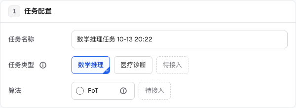

# FedAgent Studio 界面参考研究

T77按用户修正，覆盖T68的“单模型直接展示”：模型始终为选择控件，一个可选模型时也能打开并选择。复用已确认的ModelPicker／SelectField，返回真实登记引用；无新增参考、依赖或业务功能。当前规则见D74。

T76为已确认方向下的常规密度修正：复用既有Choices／单选／InfoTip，选项按内容宽度排列、待接入只显示一次，112px标签栏与16px间距，桌面36px／手机44px。没有新增主参考或功能，设计与验收见D73／HISTORY T76。实际配置截图片段：

T75 沿用已确认参考，无新视觉方向。流程为类型→文件→检查→原位修复／重试→保存→任务→发布→结构化试用；复用 Field／InfoTip／SelectField／ModelPicker 与确认。文件提供空模板，解释通过 ⓘ，JSON错误对应字段、运行时锁定；样本按类型预览，接入复制真实 JSON 与单次 API。390px算法单列，名称完整显示。验收覆盖模板、坏文件不保存、网络重试、独立评测、结构化调用和实际导出，medical-flow保存桌面／手机证据；不增加导航和管理模块。

日期：2026-10-07。已通过 Mobbin Pro 网页和官方 MCP 获取参考，保存 7 个产品、11 个流程、51 张原图，并检查各流程截图。完整来源及图片顺序见 [清单](./ui-reference-manifest.json)，操作方法见 [MOBBIN.md](./MOBBIN.md)。

T62 用户在查看实际页面后，明确确认 Braintrust、LangSmith、ElevenAgents 三个主参考，并要求只改善现有功能，不因参考增加不需要的功能。现有场景分块、首次展示全部固定配置、中文文案、参与方隐私规则继续适用。

## T62 已确认方向与实现约定

- **核心流程**：研究／实验人员选择场景，配置任务类型、算法、参与方和运行参数，提交真实任务，查看轮次与结果，选择已生成的轮次产出发布，输入同一问题对比带／不带应用。成功标准是能完成现有流程，并准确理解配置缺项、运行位置和比较对象。
- **页面布局**：浅色工作台、稳定导航、紧凑表格工具栏；新建任务固定配置面板与右侧摘要；轮次可折叠，步骤按执行位置分组；发布前在原位核对来源，试用回答固定左右对应。手机采用单栏、列表卡片和已有吸底操作栏。
- **视觉规则**：沿用 Geist／系统中文字体、既有六档字号、黑色主操作、蓝色选中／执行、绿色改善、红色错误／变差；统一控件、图标、边框、圆角、间距。减少重复介绍与规划中区域的占用，不增加无数据的指标或空图表。
- **组件映射**：直接复用并调整 Panel、Field／FieldGroup、Choices、Tag、TabLinks、Confirm、TaskTable、ProgressBar、OutputGroups、Chart；补充轻量搜索输入与导航图标。已有自定义 CSS 与组件能够完成需求，本次不增加第三方组件依赖或迁移样式体系。
- **验收条件**：桌面 1280、手机 390 可完成配置和浏览；首次打开四个固定配置区域均存在，必选项不自动选中；筛选空结果可清除条件；步骤与错误来自后端；发布核对实际任务、轮次与条数；试用结果对应提交时的输入而非后来修改的输入；长名称、长回答不溢出；键盘可达，可访问性／断行检查无新增问题；现有测试与构建通过，部署后核对页面与原有数据。
- **范围**：保留现有真实业务能力，不增加评分器编辑器、组织／权限系统、语音、版本分支、调用历史系统或实时协议；不改 FoT 提示词、算法和任务编排。本地假模型验证交互，界面修改不额外发起付费模型调用。

| 状态 | 展示与可用操作 | 后续 |
|---|---|---|
| 配置缺项／正在校验／校验失败 | 固定表单、缺项或错误；开始不可用，失败可重新检查 | 用户补齐或重新校验 |
| 正在提交／排队 | 防重复提交；返回真实任务后显示排队 | runner 领取后执行 |
| 执行 | 实际轮次、步骤、已完成样本；执行中的服务端步骤不猜测完成百分比；可暂停或取消 | 后端返回下一步骤／暂停／完成 |
| 暂停／错误暂停 | 当前步骤、错误原因；可继续或取消 | 后端恢复或取消 |
| 完成／取消 | 保留已生成结果；符合条件可删除；已有轮次产出可发布 | 发布、复制配置或删除确认 |
| 发布中／发布成功／发布失败 | 来源任务、轮次、条数和名称；发布中锁定，成功可立即试用，失败保留输入 | 应用试用或重试 |
| 试用空输入／执行／成功／失败 | 共用输入与模型；执行时锁定输入；成功显示提交快照和两侧真实回答／判分／用量；失败可重试 | 修改输入再运行 |
| 加载／读取失败／无记录／无匹配 | 已有加载提示、错误重试和空状态；无匹配可清除筛选 | 读到数据、创建或清除条件 |

## 我们要做什么

FedAgent Studio 让多个参与方的 Agent 在保留原始数据及标注的前提下，通过算法插件协作，比较本地和联邦效果，再把每轮产出发布为可试用、可接入的应用。当前可运行的是横向联邦、数学推理和 FoT；纵向／迁移算法仍未确定。

界面需要同时讲清“怎样配置一次实验”“现在运行到哪里”“是否变好、谁变差”“怎样使用产出”。据此选择实验平台、Agent 运行与发布平台、任务管理和数据比较产品作为参考。

系统名称建议保留 **FedAgent Studio**，配中文说明 **联邦智能体协作平台**。若面向论文实验，可以使用“联邦智能体实验平台”作为介绍文案；名称备选 FedAgent Lab 偏研究、FedAgent Console 偏运维，暂不改名。此处是命名建议，未检查商标或域名。

## 最值得参考的产品

| 优先级 | 产品与已核验流程 | 适合我们的页面 | 借鉴内容 |
|---|---|---|---|
| 1 | Braintrust：[创建实验](https://mobbin.com/flows/c0baa31a-140b-4b47-886c-1893f113d29d)（10 张）、[实验列表](https://mobbin.com/flows/3f5823a6-912d-4898-968c-a38993f904fb)（5 张）、[评测详情](https://mobbin.com/flows/385e0636-39e9-40f4-ac23-b7969f526224)（5 张） | 新建任务、任务结果 | 固定配置、资源快捷入口、启动反馈、汇总到明细 |
| 2 | LangChain 收录下的 LangSmith：[运行详情](https://mobbin.com/flows/c7030d07-e88b-413f-8f4d-261ae30878b9)（3 张）、[提示词比较](https://mobbin.com/flows/df9ae237-8060-48a3-bae9-2ff60ea859b7)（2 张） | 进度、调用记录、应用试用 | 列表保留上下文、步骤树、耗时／token、左右对比 |
| 3 | ElevenLabs 收录下的 ElevenAgents：[发布 Agent](https://mobbin.com/flows/b1bfc1bb-640f-4d1d-9fc7-0964955d1212)（3 张）、[预览 Agent](https://mobbin.com/flows/90fe30e3-9589-4c01-b210-4fe2188f283d)（6 张） | 发布应用、应用试用 | 预览与发布入口、版本确认、试用历史与详情 |
| 4 | Linear：[My issues](https://mobbin.com/flows/c03d421c-861f-45e9-9e0f-1f1947a46563)（4 张） | 联邦任务列表、基础管理列表 | 紧凑对齐、状态图标与文字、分组、空状态 |
| 5 | Amplitude：[比较数据](https://mobbin.com/flows/bf54f0f0-6062-4f74-a100-c47788761483)（6 张） | 本地／联邦比较、轮次变化 | 明确比较对象、固定颜色、指标与图表、明细表 |
| 6 | OpenAI Platform：[Chat](https://mobbin.com/flows/d4b2687c-751b-4700-9861-45722c5d7f09)（2 张） | 应用列表、首次使用 | 导航分组、明确创建入口、已有资源卡片 |
| 补充 | Adaline：[评测提示词](https://mobbin.com/flows/591a08be-07d0-493d-a3cc-4ae64b5ee07e)（5 张） | 结果概览与评测明细 | 运行中与完成状态、通过／失败／未知区分、原因列 |

OpenAI 本次核验的 Chat 流程只有空状态和已有资源列表，不能据此声称研究了完整 Agent Builder、评测或模型接口设置。

## 具体截图告诉我们什么

### Braintrust：新建任务最直接的参考

创建实验第 02 张一开始就列出任务、数据集、评分器和高级配置；第 03–06 张选择资源时保留整体结构，字段旁有创建资源的入口。第 07–08 张创建与启动有反馈和跳转；第 09–10 张从运行进入结果，保留数据集及实验上下文，错误行有图标和底色。

适配：保持我们已经修好的固定配置面板；算法、参与方等无可用项时在原位说明前置条件，并提供新增资源入口。主按钮旁清楚区分“正在检查”“可以创建”“已经排队／开始运行”。

实验列表第 03–05 张把表格工具放在表头上方，按数据集分组后仍保留实验行。评测详情第 02–05 张从选中行展开错误、步骤树、时间线和输入／输出，保留左侧实验信息。

适配：任务详情先显示任务状态、当前轮次、参与方和结果摘要，再查看某个步骤的错误及调用。我们应按轮次／参与方组织，不直接照搬数据集分组。该参考没有评分器时图表为空，说明不能为了仪表盘外观留下大片无意义空图。

### LangSmith：运行定位和对比

运行详情第 01 张是有搜索／筛选的调用列表；第 02–03 张显示步骤树，选中节点后查看反馈、输入、输出或属性，节点旁标出耗时和用量。提示词比较第 01 张共用一个输入，下方对应输出 A／B；第 02 张并排显示文本差异及模型配置。

适配：进度页按“轮次 → 算法步骤 → 参与方”定位；错误、重试和等待状态要可见，节点详情按内容分区。应用试用共用问题与模型，左右固定写“不带应用／带应用”，分别显示回答、判分、耗时及可获得的用量。

不把这两张提示词截图说成完整效果评测；FoT 上游提示词也不因参考 UI 而改写。桌面可用详情侧栏，手机采用独立详情或上下排列，不照搬三栏窄面板。

### ElevenAgents：产出怎样变成可用应用

发布第 01 张把 Preview 与 Publish 放在固定位置，第 02 张在确认框并排显示已发布版和当前变化，并允许版本描述；第 03 张回到 Agent 页面。预览第 02 张明确开始会话入口，第 03 张显示试用对话，第 04–06 张展示历史会话的状态、评测、耗时和用量等详情。

适配：发布确认写清来源任务、轮次、产出类型和应用名；发布后提供立即试用入口。应用详情先让用户输入问题、查看带／不带应用的结果，再按需看产出内容和接入方式。

我们发布的是冻结轮次的产出，现阶段不需要 Agent 分支、流量分配、语音、电话号码或大块 JSON 差异。发布为平台应用也不表示对公网开放。

### Linear：列表密度与空状态

第 02 张空列表仍保留导航、标题和工具，并给出创建入口；第 03 张有分组数量和紧凑任务行，第 04 张状态、名称、标签、日期沿同一行排列。隐藏记录时会说明有多少项被显示设置隐藏。

适配：保留我们“横向／纵向／迁移”三块，将搜索、任务类型、状态和创建入口组成统一工具栏；行内名称为主要信息，进度、时间和操作为辅助。无任务与筛选后无匹配要区分，后者可清除筛选。删除仍遵守已结束任务及应用保留规则。

My issues 的筛选面板和删除确认未出现在这四张图中，不据此推断 Linear 的完整筛选或删除行为。中文行高需要比英文紧凑列表更宽松，操作不能只靠悬停出现。

### Amplitude 与 Adaline：比较与解释

Amplitude 第 03 张选择比较区间，第 04–05 张用两种颜色同时标识指标、曲线和表格中的对象，第 06 张切换相对变化。适配时把时间区间改为参与方、轮次与本地基线；图表、指标卡、表格使用同一配色与名称。准确率差异主要显示百分点，基线为零不计算相对百分比。

Adaline 第 01–02 张展示评分器配置，第 03 张明确评测仍进行中，第 04–05 张显示通过／失败／未知数量与逐条原因。适配：运行完成、回答正确、尚未判分、接口调用失败分别展示；保留样本数与分母，不能把未判分当错误，也不能把运行成功当算法提升。不增加本阶段不需要的在线代码评分器编辑器。

### OpenAI Platform：作为布局补充

两张 Chat 图展示创建入口与已有提示词资源，以及 Create／Manage／Optimize 的导航分组。可参考“主要工作／基础管理”的视觉分隔、空状态按钮和应用资源的名称／时间层级；不把平台改成提示词商城，不增加无用的首页聊天框。

## 初次研究的候选建议（本次采用范围见 T62 约定）

| 顺序 | 页面 | 建议可评审的改动 | 主要参考 |
|---|---|---|---|
| 1 | 任务列表与新建任务 | 统一工具栏、表格行高及状态；配置面板、摘要和主按钮状态清晰 | Linear、Braintrust |
| 2 | 任务详情与进度 | 任务摘要、轮次／步骤／参与方位置清楚；失败可追溯 | LangSmith、Braintrust |
| 3 | 结果概览 | 先回答整体及各方是否改善；再展示曲线、分母、明细 | Amplitude、Adaline |
| 4 | 发布与应用试用 | 来源轮次确认、发布后试用、带／不带应用同问题对比 | ElevenAgents、LangSmith |
| 5 | 基础管理 | 沿用同一表格与表单规范，突出可用性和操作 | Linear、OpenAI Platform |

用户已确认浅色工作台方向和三个主参考；本次统一导航、面板、表格和表单，核对桌面／手机截图并验证现有流程。其余候选不作为本次新增设计依据；沿用现有 React／Vite 技术栈，不迁移 Next.js 或 Tailwind。

所有参考都服务于现有联邦任务流程；参与方本地原始题目和标注不因展示需求上传。开发时以真实存在的结果、状态和接口能力为准，缺失单价显示不可估算，规划中的算法明确标注。

## 本地原图

原图位于仓库 `.references/mobbin/`，流程目录与清单 `key` 相同，文件名按步骤 `01`、`02` 等排序；创建实验是 PNG，其余为 WebP，均保留 Mobbin 来源标识。本地原图不进 Git，可根据表中的稳定链接重新下载。51 是所选流程的步骤截图数，跨流程可能出现同一画面，不代表 51 个独立页面。

快捷查看：[创建表单](../.references/mobbin/braintrust-create-experiment/02.png)、[运行详情](../.references/mobbin/langsmith-run-detail/02.webp)、[发布确认](../.references/mobbin/elevenlabs-publish-agent/02.webp)、[任务列表](../.references/mobbin/linear-my-issues/04.webp)、[比较结果](../.references/mobbin/amplitude-compare-data/05.webp)。这些本地链接需要本机参考包。

## T63：操作反馈与首页入口补查（用户已确认）

用户反馈删除确认出现在页面最上方、首页三个场景图像 Demo。线上只读复现已确认：列表中的删除确认渲染在标题下、工具栏上方；`Confirm` 自动聚焦危险按钮，可能把页面从触发位置滚回顶部，关闭后未恢复焦点。应用撤下、重置、取消运行等共用确认组件，也需检查。页面级成功 Notice／flash 会占布局空间；不能仅改变确认框颜色而保留跳动与焦点问题。

通过官方 Mobbin MCP 实际完成 7 次标准检索（5 次 Flows、2 次 Screens），下载 7 个删除流程和 6 张首页候选，共 30 张原图。此聊天原生工具目录仍未刷新，通过已有线程的 app-server MCP 调用成功；没有重启用户应用、发起新模型会话或调用项目付费模型。来源、帧顺序与 SHA-256 在来源清单的 `t63_research` 中，本机原图在 `.references/mobbin/t63-feedback-home/`。

| 候选 | 实际看见的细节 | 对本项目的用途／边界 |
|---|---|---|
| [Relevance AI 删除任务](https://mobbin.com/flows/79ae5a95-0749-4444-a1cc-070591a8dfe4)，3 帧 | 选中任务后删除；中央确认、不可撤销说明、红色 Delete；列表数量 11→10，右下角绿色成功提示 | 操作确认与成功通知分开；借鉴位置、信息层级，不引入批量审批或批量删除 |
| [Braintrust 移除任务](https://mobbin.com/flows/9ef2697c-0a7b-41cd-9dd7-d6e252df5498)，3 帧 | 任务卡上的入口；中央 Remove task 对话框；关闭后原工作台卡片由 3→2 | 保持触发上下文，不跳到页面顶部；其移除未保存任务语义不能直接当作持久化永久删除 |
| [ElevenAgents 删除 Agent](https://mobbin.com/flows/59645e35-ebfc-450b-8a6a-7bb38d34b783)，3 帧 | 菜单 Delete；中央确认写出 Agent 名及关联会话的后果；返回 Agent 页面 | 写明实际对象、已发布应用保留等本项目后果，不照搬会话删除规则 |
| [LangSmith 删除数据集](https://mobbin.com/flows/f8a6927c-b30f-4667-9543-a00efa0836a8)，4 帧 | 列表选择、顶部工具、中央确认、空列表 | 检查管理页面和删除最后一项后的空状态；不引入其批量删除 |
| [Linear 删除 issue](https://mobbin.com/flows/99ee123c-27b8-4c1b-b2d7-4147d1d36e3b)，3 帧 | 中央确认写明子事项及 30 日保留，Cancel 有焦点轮廓；结果是 Deleted 与 Restore issue | 仅补充确认布局；我们的永久删除没有恢复能力，不能增加假的撤销／恢复 |
| [Manus 删除任务](https://mobbin.com/flows/3f02bec2-a96f-421e-9009-c67a40cc1c73)，3 帧 | 中央确认说明部署站点将一并删除；完成后顶部浮层 Deleted successfully | 补充操作后果和浮层反馈；我们的应用保留规则相反，不能照搬其文案 |

以上截图不证明 Esc、焦点约束／恢复、请求锁定、超时、失败与重试等行为，这些分支需按真实接口设计和浏览器验证。错误应保留在对应对话框或字段附近；长期的运行异常与加载错误仍需就地展示，不能全部改成短暂通知。

首页优先候选：

- [Replit Design 入口](https://mobbin.com/screens/47a2f738-9f05-47c9-b81e-d5e8df462595)：浅色点阵、柔和渐变背景、白色卡片与有层次的插图。适合既有浅色工作台；只借鉴背景／卡片，不加入模板库、聊天、画布或导入工具。
- [Higgsfield 三个入口](https://mobbin.com/screens/49b0ae57-9488-4155-938e-a3f9492b5013)：三个入口分别用颜色和内部关系图区分。适合替换三个场景的扁平表格示意，保持我们自己的横向／纵向／迁移语义；建议转为浅色，不照搬深色全站、节点编辑器或生成能力。静态截图未证明动画，拟议悬停变化属于本项目适配。

Browserbase 全屏彩色纹理过强，Recraft 是营销首页，Unify 的主体是聊天，Copilot 的图案偏消费产品，本轮不作为主参考。建议只补充 Replit 的浅色氛围和 Higgsfield 的入口区分方式，不继续扩大候选。

**2026-10-08 用户以“开始吧”明确确认范围**：居中确认与轻量成功反馈；三个入口的原创联邦关系图、低强度背景及悬停／键盘焦点变化；保留可用／规划中状态，不增加业务功能。确认后开始实现，保留现有 React／Vite／CSS 与组件，不增加第三方依赖。

### T63 实现约定

- **核心流程**：从原任务行／管理操作打开确认，在当前视口核对对象与真实后果，取消返回原操作；提交成功后原数据刷新并轻量通知，失败留在确认中重试。首页仍只选择三个联邦场景，横向进入配置，纵向／迁移保持规划中。
- **布局／视觉**：确认使用居中白色模态对话框与遮罩，不占页面布局；移动端限宽与限高，内容可滚动。成功通知桌面右下、手机避开吸底操作栏，错误按操作／字段／任务位置保留。首页浅色渐变和局部点阵、白色卡片、原创矢量联邦关系图；微动效只在可用入口悬停／键盘聚焦发生，减少动态偏好下关闭。
- **组件映射**：复用 Confirm，改用浏览器原生 dialog 的模态与键盘能力；补充轻量 Toast，保留 Notice 作为持续状态提示；复用既有 Button／Tag／PageHead／Icon；ScenarioArt 改为源码中的 SVG 节点、互补面板和跨域路径，无图片网络依赖。新建任务移除桌面／手机重复确认实例，统一一个对话框。
- **验收**：从长列表底部打开无滚动跳顶、布局不位移；默认焦点为取消，Tab 不跑到背景，Esc／取消恢复触发位置；请求中不重复提交，不误关闭；错误可见、原对象保留、重试成功；删除最后一项有空状态，删源任务不影响已发布应用；成功通知不遮挡移动操作，不抢焦点且可关闭／自动消失，停留或聚焦暂停计时；首页 1280／390 无溢出、规划中不误导为可用，键盘和 reduced-motion 可用；现有测试、构建、可访问性与断行通过，部署保留用户数据。

| 状态 | 展示／可用操作 | 下一状态 |
|---|---|---|
| 待确认 | 对象名称、后果、取消与确认；默认取消焦点 | 取消返回触发处，或提交 |
| 提交中 | 正在处理，锁定确认与关闭，背景不可操作 | API 成功或错误 |
| 失败 | 对话框内真实错误，取消／重试；不关闭对象上下文 | 用户重试或取消 |
| 成功 | 关闭确认、刷新实际内容、轻量成功通知 | 下一次操作；通知可关闭／自动消失 |
| 页面持续异常／字段错误 | 就地保留错误和恢复入口，不放短暂通知 | 修正、重试或状态更新 |
| 首页可用／规划中 | 可用有配置入口与焦点／悬停反馈；规划中只说明场景并标明状态 | 可用进入任务配置 |

## T65：参与方详情的信息层级

用户指出参与方展开行全是文字且位置零散。本次沿用已确认的 Braintrust／LangSmith 信息分区、渐进展开和既有组件规范，不新增主参考或业务功能。

- **核心流程**：在列表识别参与方、数据集及状态，展开查看基本信息，按需要预览样本或打开本地客户端连接，依次安装、设置环境变量、运行；对应段落复制，失败原位重试。
- **布局**：参与方名称与机构上下排列，状态独立成列；展开内容采用数据集信息／参与方信息两块，手机上下排列。样本与连接指南默认折叠，新增与删除操作在固定区域；指南的标题、签发与复制跟随对应步骤，不漂在内容上方。
- **状态**：安装包加载／读取失败可重试／尚未发布分别显示；令牌签发中禁用、失败留在环境变量段、成功仅显示一次，折叠连接指南不丢失本次令牌；状态与样本／标注分母仍来自后端。
- **组件映射**：复用 Facts、Collapsible、Tag、Confirm、Notice 和 CodeBlock；CodeBlock 增加可选标题／动作区与对应复制名称，原有代码块保持原行为。沿用现有 CSS，无新增依赖。
- **验收**：1280／390 名称、机构和状态不混排，默认详情没有大段命令或样本；三段复制各取本段，shell 占位符正确加引号，连接参数不会变成重定向；键盘展开与错误重试、一次性令牌的内存状态可验证，安装包来自平台；长代码在块内滚动，不撑宽页面，样本展开目标满足触屏尺寸。令牌／安装包异常用明确响应夹具验证，不签发生产凭据或发起模型调用。

## T66：补足切换与操作动效

用户直接要求为界面切换补充动画。沿用已确认方向，本次属于常规交互细节，不新增参考、业务内容或组件依赖。

- **核心流程**：点击导航后立即进入新页面；点击任务／应用标签后立即展示对应内容；展开指南与完成轮次时平滑开合；确认框／成功通知轻量入场，取消与提交保持既有语义。
- **布局**：页面 180ms 淡入，不位移整页；标签内容同等时长、最多向上移动 4px。参与方展开内容淡入，确认框 150ms、6px／1.5% 的轻微入场，遮罩同步渐显；通知和手机菜单短促入场。没有转场等待、全站特效或连续装饰动画。
- **组件映射**：现有 App／TaskPage／AppPage 复用原生 Web Animations 的 `useContentMotion`；Confirm／Toast／参与方详情复用 CSS；基础管理分组用 grid 高度过渡并用 inert 隔离收起内容；Collapsible／轮次沿用原生 details，支持的浏览器通过 `::details-content` 与 `interpolate-size` 平滑开合，旧浏览器直接开合。轮次首次打开后保留步骤，收起时不提前移除内容。
- **验收**：快速切换取消旧动画；后台刷新、表单编辑不重播；草稿与父级编辑状态保留，不用 key 重挂载；移动固定底栏位置不变；默认取消焦点、关闭恢复和原生键盘展开正常；减少动态设置在操作前或播放途中都生效；桌面／手机实际截图、全站可访问性和九个宽度断行无新增问题。只读浏览器回归禁止 API 写入／模型调用，本地 Toast 仅使用前端通知夹具。

| 状态 | 展示与操作 | 下一状态 |
|---|---|---|
| 点击导航／标签 | 立即更新内容与选中项，短促淡入，不锁定点击 | 完成；连续点击取消前一次动画 |
| 展开／收起 | 原生 open 与箭头同步改变，支持的浏览器平滑高度过渡 | 内容可操作／原生折叠；分组隐藏链接 inert |
| 后台刷新／编辑字段 | 原内容即时更新，保持既有状态 | 不触发页面转场 |
| 确认／成功通知出现 | 不改变页面滚动与业务规则，轻量入场 | 继续原确认／通知流程 |
| 减少动态／旧浏览器 | 减少动态立即呈现最终状态；不支持高度插值时原生直接开合 | 核心交互仍可用 |

原生折叠增强依据：[MDN details-content](https://developer.mozilla.org/en-US/docs/Web/CSS/Reference/Selectors/::details-content)、[MDN interpolate-size](https://developer.mozilla.org/en-US/docs/Web/CSS/Reference/Properties/interpolate-size)。只作为技术兼容资料，不声称 Mobbin 静态帧证明了这些动画。

## T67：统一选择菜单与增强切换反馈

用户看到真实预览后回复“好的 开始改吧”（2026-10-09），确认以下参考；不增加参考产品的业务功能。当前会话的直接 MCP 返回认证错误，通过本机已授权的 Mobbin app-server 连接实际完成标准 Flow／Screen 检索，原图与 SHA256 保存在 `.references/mobbin/t67-select/`，来源记录在 `ui-reference-manifest.json`。

- [Gumloop 任务筛选菜单](https://mobbin.com/screens/3fb4cfb8-3cbf-4f3a-8089-8e67db76cb67)：借鉴弹层与控件的对齐、紧凑行距、浅色高亮与右侧勾选；状态／任务类型／模型／数据集沿用同一套。原图中搜索与额外筛选字段不引入本项目。
- [Linear Filtering issues Flow](https://mobbin.com/flows/f7e892c1-7f23-4267-a950-ed9c4bb904dc)：六帧实际查看，关键第 2／3 帧依次为展开状态选项、选择后更新列表，第 6 帧为无结果；借鉴即时选中反馈和现有清除筛选，保留平台简单单选，不增加嵌套筛选或保存视图。
- 技术依据：[shadcn/ui Select](https://ui.shadcn.com/docs/components/radix/select) 的实际展开示例及 [Radix Select](https://www.radix-ui.com/primitives/docs/components/select)。Radix 2.3.8 支持当前 React 19，MIT；直接复用交互原语并沿用本项目 CSS，不迁移 Tailwind 或 Next.js。静态 Mobbin 帧不作为动画时长证据。

**核心流程**：点击／键盘打开选择 → 查看当前项和可选项 → 选择后立即写入现有页面状态 → 列表／表单／摘要按原规则更新 → 关闭并回到触发器。Esc、外部点击取消选择；导航与标签立即切换，无额外等待。

**布局规则**：触发器沿用字段高度和两栏表单，文字过长截断并提供完整 title；弹层从控件边缘对齐、6px 间距，视口边界自动避让，限高 320px 并支持滚动；选项桌面至少 36px、窄屏至少 44px。单独勾选与当前悬停／键盘焦点分别表达，不使用系统蓝色整行。手机两项筛选平分一行，清除操作换行。菜单开／关 160／120ms；正常页面内容 240ms、0→1 淡入和 8px 位移，固定底栏与通知独立；标签内容同样反馈，底部指示条平滑滑动。减少动态时直接到达最终状态。

| 状态 | 展示与用户操作 | 下一状态 |
|---|---|---|
| 未选择／前置缺失 | 占位文字；依赖控件禁用，已有固定配置区保留 | 满足前置条件后启用 |
| 关闭且已有值 | 显示当前标签，点击、Enter、Space、方向键可打开 | 展开 |
| 展开 | 当前值勾选，悬停／方向键高亮；长列表滚动，Home／End／输入文字定位 | 选择／取消 |
| 选择 | 回调原业务状态；空字符串的“不限”与未选择占位分开映射 | 关闭并恢复焦点 |
| Esc／外部点击 | 关闭，保持原值，恢复触发器焦点 | 可再次打开 |
| 保存／运行锁定 | 保持已有 disabled 条件，不允许修改模型或版本 | 原业务恢复后启用 |
| 换页／标签／快速连续点击 | 即时内容更新、滑动指示；取消上一段动画，保留草稿／父级状态 | 完成，不随后台轮询重播 |
| 减少动态 | 禁止位移和渐变；偏好中途改变也取消动画 | 相同操作与结果 |

**组件映射**：新增共享 SelectField，使用 Radix Root／Trigger／Portal／Content／Viewport／Item／Indicator／ScrollButton；既有 option 仅声明选项数据，不渲染原生可见菜单，回调为字符串值。复用 Icon 与主题变量，任务类型包装器继续复用；列表状态、模型、数据集、版本、算法参数和参与方单独模型全部接入。Radix 处理键盘与焦点、弹层边界；本项目处理空值映射、真实字段值和弹层点击隔离（防止冒泡误切换表格勾选）。TabLinks／useContentMotion 沿用原生能力，不增加动画库。

**验收条件**：桌面 1280／窄屏 390 实际展开与筛选正确；键盘、Esc、外部点击和焦点恢复；前置禁用、不默认选择参与方、有效空值恢复；长菜单尾部可达、文字和弹层不溢出；鼠标选题库不会反向取消参与方；枚举与模型状态接通；标签指示条定位、快速切换、草稿保留和固定底栏正常；生产构建下动画单位正确，减少动态有效。复用现有确认／参与方回归与全站可访问性／九宽度检查，纯 UI 不新增付费模型调用。菜单专门回归 `tools/ui-check/select.mjs`，本地长模型／多题库为响应夹具，线上禁用夹具并阻止业务写入。

## T68：任务配置逐项排布与上下文说明

2026-10-10 用户在看到实际参考后回复“开始吧”，确认逐项配置、名称与介绍分离的方向。本会话官方 Mobbin MCP 已实际完成 3 次标准检索（Screens／Flows／Screens），与 T67 的连接状态分别记录；未使用 Deep Search。原图 10 张及 SHA256 在 `.references/mobbin/t68-config/`，来源见 `ui-reference-manifest.json`。

- 主参考 [Mistral AI Adding an agent information](https://mobbin.com/flows/8d58b223-ebe8-4f95-9c57-3de32e8baeab)：实际查看 7 帧；第 2 帧模型菜单将介绍分到浮层，第 3／5／6 帧参数名称与 ⓘ 分离。借鉴统一配置轴线、短名称与上下文介绍，不引入其 Agent 聊天／指令功能。参数 ⓘ 在原图未展开，不能据此声称已观察到其 hover／触屏行为。
- 主参考 [Mintlify 设置页](https://mobbin.com/screens/9385a5a5-8bcb-4eca-87be-9769c794dc5b)：实际查看；借鉴清晰分组和名称旁的说明入口。保留平台既有四个配置面板，不复制文档站、权限或其他设置。
- 技术与实际示例：[AI Elements ModelSelector](https://elements.ai-sdk.dev/components/model-selector) 的搜索、接口分组与选择弹窗已在浏览器展开查看；[shadcn Tooltip](https://ui.shadcn.com/docs/components/radix/tooltip)／Radix 用于字段解释。官方 Agent／Task 组件为配置结果与执行步骤展示，不适合冒充配置表单，因此没有引入。

**核心流程**：从横向场景进入 → 固定配置面板齐全 → 用户依次选类型、算法、参与方 → 设置运行方式、样本数、轮次和模型 → 需要时读取 ⓘ／调整高级参数 → 原有后端校验 → 创建并运行。用户先选、前置置灰、运行与确认语义不变；模型选择只显示后端登记的模型，只有一个时直接展示。

**页面布局**：任务配置普通字段每项一行，桌面 148px 标签列、20px 间隔、余下控件列；窄面板 ≤480px 同一字段内改为上标签下控件，仍逐项排列。类型／轮次选项等分同一控件区域，算法为等宽短名称选项，名称旁的 ⓘ 独立于选择点击区；参与方继续独立复选表格。说明 max340px、12px 视口避让，桌面 ⓘ28px、窄屏触区44px；字号、颜色、圆角沿用主题。试跑样本行在正式运行时保留、禁用并显示“全部样本”，切回保留原值；高级配置继续收起。必要前置、错误、单位和真实可用状态仍直接显示，避免把操作必需信息藏入说明。

| 状态 | 展示与用户操作 | 下一状态 |
|---|---|---|
| 刚打开／前置未选 | 固定面板及通用字段保留，算法与轮次按依赖禁用；算法说明仍可读 | 用户选择前置后启用 |
| 普通字段 | 一行同一轴线，名称短、控件等宽 | 选择即时更新草稿／摘要与原有校验 |
| ⓘ 悬停／键盘聚焦 | 浮层展示注册表或字段介绍，不占布局，不改变值 | 离开／移走焦点关闭 |
| ⓘ 点按／触屏 | 固定说明供阅读；按钮与选择操作独立 | 再次点按／外部点击／Esc／移走焦点关闭 |
| 试跑／正式运行切换 | 样本行一直存在；正式运行禁用并明确全部样本 | 切回恢复试跑样本数 |
| 模型弹窗打开（多模型） | 居中、搜索初始焦点、按接口分组，当前值带勾选 | 搜索／方向键／点击或回车选择 |
| 模型匹配为空 | “没有匹配的模型”；保持已有模型 | 修改查询或取消 |
| 模型选择／取消 | 选择回传真实模型引用；取消保持原值 | 关闭并恢复触发焦点 |
| 一个模型／前置错误／校验失败 | 单模型直接显示；错误与必要前置继续原位显示 | 按原流程配置或修正，不虚构执行进度 |

**组件映射**：Field／FieldGroup、Choices、Panel、UnitInput、参与方表格与主题沿用；短名称 AlgorithmTable 是注册表驱动的自定义业务适配。InfoTip 复用 `@radix-ui/react-tooltip@1.3.0`，补齐点按固定／关闭并隔离 Portal 触发器外部点击；公共 Field 的旧内联“说明”统一替换为浮层，其他表单版式保留。模型选择按 AI Elements 官方源码 commit `6a9d5b1822ffb10bba4bd97175f01edd7d8651cd` 保留 ModelSelector 组合 API，改用项目 CSS、Radix Dialog 1.2.0 与 cmdk 1.1.1；AI Elements 实际根许可证为 Apache-2.0（区别于 Radix／cmdk 的 MIT），许可与修改归属在 `app/src/ui/ai-elements/LICENSE`／`NOTICE`，构建分发包含 `/licenses/ai-elements.txt`。逐组件核对 React 19 兼容性；选中源码无需 Next.js／AI SDK 运行时，未为此迁移 Tailwind、框架或后端。没有复制示例供应商、远程 Logo、无关功能。

**验收条件**：桌面1280／手机390 逐行对齐、固定字段首次可见、无横向溢出；真实 hover、键盘聚焦与 Tab／Esc、触屏点按／再次点按／外部关闭，说明不重排也不误选算法；模式切换样本行与值保留；模型搜索／空状态／回车、引用回传与焦点恢复；原默认／单独模型、枚举、题库、草稿、确认和动效回归；全站可访问性87组合与九宽度断行，生产构建和线上复测。新增 `tools/ui-check/config.mjs`；本地多模型是响应夹具，线上关闭夹具，阻止业务写入和模型调用。仅 UI 调整不重复付费模型试跑。

## T69：合并单字段分区，较多单选收进菜单，重置与提示分开

2026-10-10 用户直接修正规则，沿用 T67／T68 已确认的菜单、配置和反馈参考，不扩展新风格或产品功能。

- **核心流程**：在“任务配置”同时填写名称、类型和算法 → 选择参与方 → 配置运行 → 原有校验／创建。需要重新开始时点击页头独立“重置配置” → 确认后回到初始配置；取消保留草稿。
- **布局**：合并单字段“基本信息”，固定分区改为任务配置／参与方／运行配置（1–3）；高级配置仍收起。普通配置逐项对齐不变。互斥选择 2–3 项直接比较，超过3项由共享 Choices 复用 SelectField 收起，轮次五项不再平铺；多模型仍使用已接入的 ModelPicker。
- **状态**：首次打开重置按钮可见但禁用；用户修改或恢复草稿后启用，创建中禁用。恢复／复制提示仅显示信息与关闭操作；打开重置确认时提示保留，不让页面因消息消失重排。取消／Esc恢复按钮焦点并保留名称、选择、参数；确认清除名称覆盖、类型、算法、参与方、参数、恢复提示和旧创建错误，通用默认值恢复，轮次重新等待算法，不调用任务删除或创建接口。
- **组件映射**：复用 PageHead.actions、Button、Notice、统一 Confirm、Field／Panel；Choices超过3项使用已有Radix SelectField，按原选项映射回字符串／数字，不新增库。重置、放弃、正式运行共用单一确认入口，避免两套模态。
- **验收**：桌面／手机只有三个固定分区、名称归入首区；轮次菜单真实键盘选择与数字状态／摘要接通；独立重置的禁用／恢复草稿／取消保留／确认清除／焦点正确；确认居中，信息提示与菜单不重排。既有模型、Tooltip、确认与动效回归，前后端检查、全站可访问性与九宽度断行，实际本地假模型完整流程及线上只读复测；不增加付费模型调用。

## T70：参与方只列可用项，重置跟随配置，限制表单宽度

用户直接要求修正参与方筛选、重置位置与左栏宽度，沿用已确认的T67／T68参考和组件。

- **核心流程**：选择类型／算法 → 勾选当前可用参与方及就绪题库 → 调整运行配置 → 原有校验／创建；重置在高级配置之后，跟随左侧配置区。
- **布局**：桌面页面总宽最多900px，左栏600px、摘要280px、间距20px；名称列148px和20px间隔保留，输入区约390px。摘要下移的视口，表单仍最多600px；手机按屏幕减32px铺开。参与方表格保留名称、数据集、样本与运行位置，移除重复状态列。
- **组件映射**：沿用Panel／Field／ParticipantTable、SelectField、Confirm与现有CSS；候选使用既有在线、题库就绪和场景／类型兼容条件，重置按钮放order-main末尾，不改变后端准入。无新依赖或业务功能。

| 状态 | 展示与操作 | 后续 |
|---|---|---|
| 前置未选 | 固定参与方分区与选类型／算法提示 | 用户自行选择前置 |
| 有可用参与方 | 仅显示在线且有兼容、就绪题库的行；全选、单选题库保持原行为 | 原有后端校验与运行 |
| 没有可用参与方 | 一条空态，新增入口保留，创建禁用 | 登记／接入可用资源后再选 |
| 已选资源失效 | 不计入可参加数量，缺少最低参与方时禁止创建；不虚构可用性 | 修改选择或重新准备资源 |
| 配置底部重置 | 未修改／创建中禁用；取消保留，确认恢复初始配置 | 原确认与焦点规则不变 |

**验收条件**：桌面／手机仅显示真正可用行、就绪题库，空态和失效草稿准确，状态列不重复；宽屏控件不无限变宽、窄屏无横向溢出／不当断行；重置在高级配置后，取消保留和确认清理正确；配置、菜单、确认、动效、全站可访问性／九宽度、实际本地假模型流程及生产构建／线上只读检查。不可用夹具只改本地响应，不更改生产参与方状态或记录。

## T71：静默恢复、错误原位反馈与摘要旁重置

2026-10-12用户直接修正，沿用已确认的配置与反馈参考；不新增主参考、依赖或业务功能。

- **核心流程**：进入配置页静默恢复草稿 → 编辑 → 点击开始；有缺项时在对应配置下方指出并滚动／聚焦，修正后清除 → 校验通过后按原流程创建。摘要旁重置继续使用居中确认；移除页面级取消，保留确认框取消。
- **布局**：移除恢复／复制／创建失败的顶部Notice与摘要缺项汇总。重置紧邻右侧摘要标题，窄屏摘要下移时仍同排；只有一个可见开始入口。错误在类型、算法、参与方、轮次、模型或高级参数区域，创建／网络错误留在开始操作区。限宽、三个分区和字段轴线不变。
- **组件映射**：复用Panel.actions、Field.error、Choices、SelectField、ModelPicker与Confirm；补齐错误id、aria-invalid／describedby和播报。短促反馈使用原生Web Animations 260ms，不新增动画库、不重挂载。

| 状态 | 展示与操作 | 后续 |
|---|---|---|
| 初次打开／恢复草稿 | 无顶部提示，尝试开始前不显示缺项；保留真实草稿值 | 编辑或开始 |
| 缺项后点击开始 | 按钮短促震动；错误在对应区域，定位第一处 | 修正即清除，不发送创建请求 |
| 后端配置不通过 | 错误映射到配置区域，高级参数必要时展开 | 修改后重新校验 |
| 校验中／创建中 | 开始锁定，显示真实检查或创建状态 | 结果到达后解锁或进入任务 |
| 网络／创建失败 | 开始附近错误；正式运行失败留在确认中 | 原位重试或重置 |
| 重置确认 | 取消保留草稿与错误并恢复焦点；确认恢复初始值 | 留在配置页，无删除或创建请求 |
| 减少动态 | 文字、滚动定位和焦点完整，不震动 | 同一校验与创建规则 |

**验收条件**：桌面1280／手机390无恢复栏，刷新保留草稿；重置与摘要同排、页面无取消；缺项鼠标／键盘开始定位对应错误，修正清除，后端错误覆盖模型／轮次／高级参数；减少动态不震动；不完整配置不写任务。保留配置、确认、选择、动效回归；生产构建与线上只读检查、前后端测试、可访问性87组合／九宽度、本地假模型完整流程。纯UI不新增付费调用。

### T81 复用范围

用户批准按三类资源与任务前测试方案实现，并确认用独立参考Agent联调。沿用上述T62／T67／T68已确认的控制台、选择菜单与配置规范，不新增视觉参考、功能模板或框架。Agent接入复用ResourceDialog／FormActions／SelectField，LLM仍用AI Elements ModelPicker；测试成功用原生details收起明细，失败原位展开。流程、状态表、布局、组件映射与验收见FLOW的T81，实际图片见screenshots/agent-resources。没有把普通聊天LLM接口包装成Agent，也未引入聊天、Agent托管或其他参考产品的额外功能。
